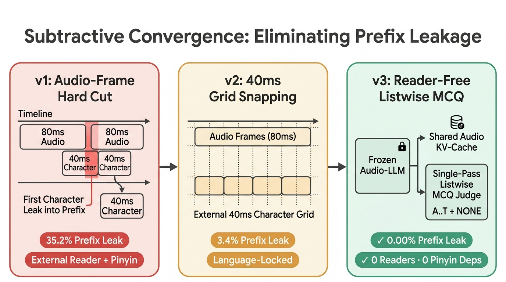
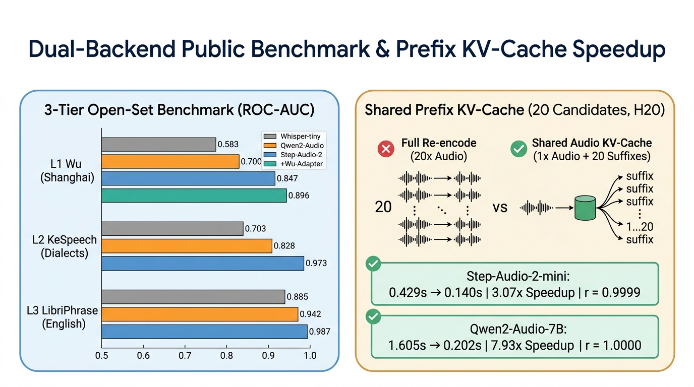
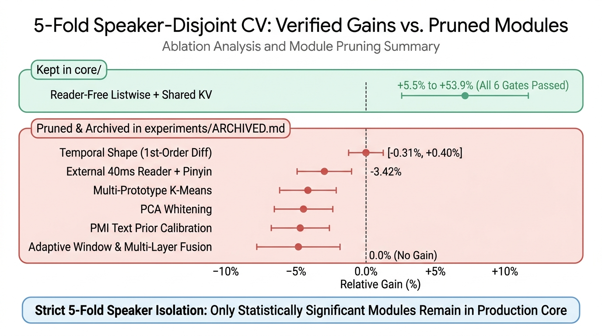

<p align="center">
  <a href="https://github.com/leeoisaboy/audiollm-latent-kws">
    
  </a>
</p>

<p align="center">
  <a href="README.md"></a>
  <a href="https://leeoisaboy.github.io/audiollm-latent-kws/"></a>
  <a href="https://huggingface.co/datasets/Leeoisaboy/audiollm-latent-kws-bench"></a>
  <a href="https://leeoisaboy.github.io/disentangle-acoustic-print/"></a>
  
  
</p>

<h1 align="center">AudioLLM-Latent-KWS</h1>

<p align="center"><strong>Subtracting couplings from frozen Audio-LLMs so two short recordings are enough to spot a new keyword across dialects and languages.</strong></p>

<p align="center">
  
  <br />
  <sub>Figure 1: Language-agnostic 5-step pipeline and dual-backend public benchmark architecture</sub>
</p>

Teaching a voice device a brand-new phrase—a regional dialect phrase or a custom wake word—usually means collecting hundreds of recordings and retraining a model on GPUs. Last month we released an early research prototype exploring a lighter route: freeze an off-the-shelf Audio-LLM without changing a single weight, enroll just a couple of user recordings, and spot that phrase in subsequent speech.

While that prototype worked on a private Wu-dialect corpus, it carried heavy baggage: an external 40 ms character reader for timestamp alignment, a Mandarin `pypinyin` dependency, and hardcoded layer/window constants. That made external reproduction hard and broke immediately outside Chinese dialects.

This update focuses on **architectural subtraction, dependency decoupling, and open public verification**. The entire pipeline is distilled into a language-agnostic five-step engine and verified end-to-end across Shanghainese, multi-dialect Chinese, and English public benchmarks on two structurally distinct frozen Audio-LLMs.

## 1. Subtractive Convergence: Driving Prefix Leakage to Zero

The system spots keywords in two intuitive stages: first scan the audio quickly to shortlist 20 plausible candidates; then weigh context to pick the true phrase—or reject the utterance if no target keyword was spoken.

The old prototype struggled at the boundary cut in Stage 2. Pairing an 80 ms audio grid with an external 40 ms character reader caused naive frame cuts to leak the target's first character into the left prompt 35.2% of the time—like accidentally printing the first letter of the answer inside the exam question. Snapping to the 40 ms grid lowered leakage to 3.4%, yet still dragged along an external reader and Mandarin Pinyin library.

In this release, both the external character reader and Pinyin library are completely removed. Static AST auditing confirms zero language-specific or phonetic dependencies inside [`core/`](core/).

<p align="center">
  
  <br />
  <sub>Figure 2: From audio hard-cut (35.2% leak) and 40 ms grid snapping (3.4% leak) to reader-free Listwise MCQ (0.00% leak)</sub>
</p>

With the external character rail gone, Stage 2 becomes a **Shared-Audio-KV Listwise Multiple-Choice** test: the frozen Audio-LLM attends once to the cached audio and evaluates all 20 candidates alongside a `NONE` rejection option (`A..T + NONE`), run in both forward and reversed option order to cancel position bias. Prefix leakage drops to **0.00%**, and everyday chatter without keywords is cleanly rejected.

The core engine now consists of five pure functions: `enroll` (auto-computing window frames from median enrollment duration), `locate` (shallow latent cosine / 3-part temporal pyramid), `safe_prefix_cut`, `kv_rerank` (per-pool z-score fusion), and `threshold` (open-set rejection). Underneath, [`integration/backend.py`](integration/backend.py) reduces model integration to just three methods—`extract_shallow`, `prefill_prefix_kv`, and `score_suffixes`—verified on both `Step-Audio-2-mini` (80 ms/frame) and `Qwen2-Audio-7B-Instruct` (40 ms/frame).

## 2. Open Benchmarks & Automated Release Gates

All three pre-segmented, speaker-disjoint public benchmarks are published at **[Leeoisaboy/audiollm-latent-kws-bench](https://huggingface.co/datasets/Leeoisaboy/audiollm-latent-kws-bench)** (each with 40 keywords, 120 enrollment clips, 180 positive utterances, and 180 negative utterances):

- **L1 Shanghainese (Wu)**: `Shanghai_Dialect_Conversational_Speech_Corpus` (14 speakers)
- **L2 Cross-Chinese Dialects**: `KeSpeech` multi-dialect test split (96 speakers)
- **L3 English Open-Set**: `LibriPhrase` (160 speakers, 50% hard negatives + 50% easy negatives)

[`analysis/gates.py`](analysis/gates.py) encodes six hard release gates covering Stage-1 recall (`R@20 ≥ 85%`), net reranking gain, zero prefix leakage, open-set `ROC-AUC` / `Recall@5%FAR`, and KV-Cache parity.

## 3. Dual-Backend H20 Results & Prefix KV-Cache Speedup

Sweeping all 11 layers of `Qwen2-Audio` revealed that its bidirectional `audio_tower` output (`layer=-2`, prior to causal text-prompt mixing) lifts Top-20 recall by **+22.8 to +42.5 pp** over `layer=2`, bringing both heterogeneous models well above the 85% recall floor on every tier:

| Tier | Model / Baseline | R@20 | Final Top-1 | Open-Set AUC | Recall@5%FAR | Latency/utt |
| --- | --- | ---: | ---: | ---: | ---: | ---: |
| L1 Wu | Whisper-tiny Baseline | — | 3.3% | 0.583 | 4.4% | 0.697s |
| L1 Wu | Qwen2-Audio (`layer=-2`) | 87.7% | 26.7% | 0.700 | 16.7% | 0.168s |
| L1 Wu | **Step-Audio-2 (`layer=2`)** | **96.2%** | **40.4%** | **0.847** | **31.7%** | **0.124s** |
| L2 Dialects | Whisper-tiny Baseline | — | 44.4% | 0.703 | 40.0% | 0.125s |
| L2 Dialects | Qwen2-Audio (`layer=-2`) | 94.4% | 61.7% | 0.828 | 50.6% | 0.174s |
| L2 Dialects | **Step-Audio-2 (`layer=2`)** | **99.1%** | **72.4%** | **0.973** | **90.6%** | **0.121s** |
| L3 English | Whisper-tiny Baseline | — | 73.9% | 0.885 | 73.3% | 0.160s |
| L3 English | Qwen2-Audio (`layer=-2`) | 97.8% | 90.6% | 0.942 | 57.2% | 0.151s |
| L3 English | **Step-Audio-2 (`layer=2`)** | **100.0%** | **97.8%** | **0.987** | **91.7%** | **0.114s** |

On L1 conversational Shanghainese, 35% of utterances contain 2–7 target words simultaneously, capping single-winner occurrence Top-1 at `180/292 = 61.6%` even for an oracle. Under utterance-level `Utt-Hit@1`, the base model with a 3-part temporal pyramid + pairwise verification reaches **61.7%**, and pairing public Wu adapters (`Wu-ASR` shallow + `Wu-Und` Listwise) reaches **99.3% R@20, 72.2% Utt-Hit@1, 93.9% Utt-Hit@5, 73.9% Macro-F1, and 0.896 AUC** (see [`docs/CONVERGENCE_RESULTS.md`](docs/CONVERGENCE_RESULTS.md)).

<p align="center">
  
  <br />
  <sub>Figure 3: Left — 3-tier open-set ROC-AUC; Right — 20-candidate Shared Audio KV-Cache speedup & numerical parity on H20</sub>
</p>

| Frozen Backend | 20× Full Recompute | Shared Audio KV-Cache | H20 Speedup | Pearson / Spearman `r` | Max Abs Diff |
| --- | ---: | ---: | ---: | ---: | ---: |
| `Step-Audio-2-mini` | 0.429s | 0.140s | **3.07×** | 0.99993 / 0.99992 | 0.032 nats |
| `Qwen2-Audio-7B-Instruct` | 1.605s | 0.202s | **7.93×** | 1.00000 / 1.00000 | 0.011 nats |

## 4. Seven Pruned Negative Experiments

Every branch that lost or crossed zero under 5-fold speaker-disjoint cross-validation has been stripped from the `pyproject.toml` production package and documented in [`experiments/ARCHIVED.md`](experiments/ARCHIVED.md) (standalone acoustic trajectory disentanglement continues in sister repo [disentangle-acoustic-print](https://github.com/leeoisaboy/disentangle-acoustic-print)).

<p align="center">
  
  <br />
  <sub>Figure 4: Strict 5-fold speaker-disjoint CV summary — only statistically positive modules remain in core/</sub>
</p>

## 5. White-Box Audit Studio & Quick Start

<p align="center">
  <a href="https://leeoisaboy.github.io/audiollm-latent-kws/">
    
  </a>
</p>

<p align="center"><strong><a href="https://leeoisaboy.github.io/audiollm-latent-kws/">▶ Open Latent-KWS Audit Studio</a></strong></p>

```bash
git clone https://github.com/leeoisaboy/audiollm-latent-kws.git
cd audiollm-latent-kws
python -m venv .venv
python -m pip install -e ".[dev]"
pytest -q

# Preview the zero-backend Audit Studio locally
python -m http.server 8766 --directory studio
```

- **Repository**: [AudioLLM-Latent-KWS](https://github.com/leeoisaboy/audiollm-latent-kws)
- **Live Audit Studio**: https://leeoisaboy.github.io/audiollm-latent-kws/
- **Public Benchmark**: https://huggingface.co/datasets/Leeoisaboy/audiollm-latent-kws-bench

**Trim away redundant couplings, and the capabilities that truly hold up stand out on their own.**
