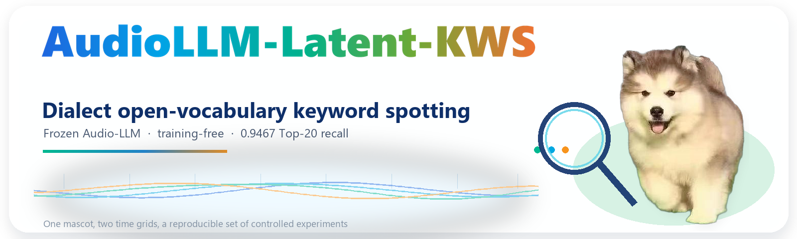
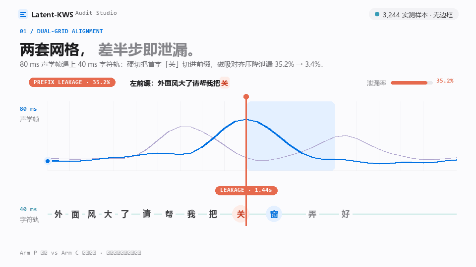
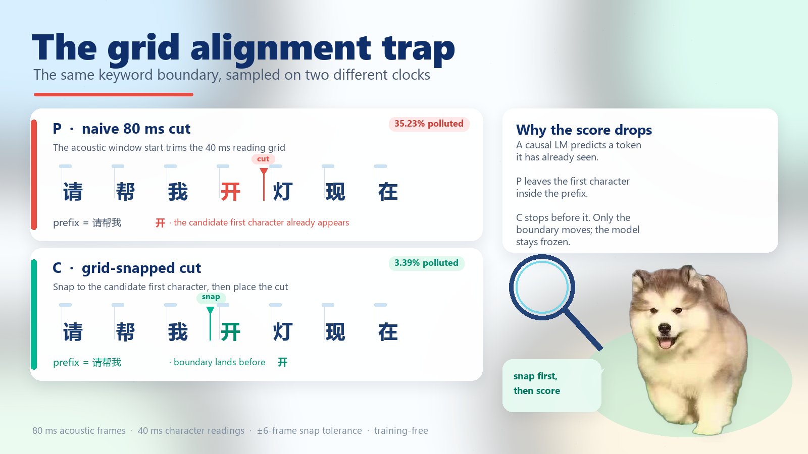

<p align="center">
  <a href="https://github.com/leeoisaboy/audiollm-latent-kws">
    
  </a>
</p>

<p align="center">
  <a href="README.md"></a>
  <a href="https://leeoisaboy.github.io/audiollm-latent-kws/"></a>
  <a href="https://leeoisaboy.github.io/disentangle-acoustic-print/"></a>
  
  
</p>

<h1 align="center">AudioLLM-Latent-KWS</h1>

<p align="center"><strong>Add a new dialect command with just a few recordings—no retraining, with recall, prefix leakage, and 7 negative experiments laid bare.</strong></p>

## The Live Audit Studio

<p align="center">
  <a href="https://leeoisaboy.github.io/audiollm-latent-kws/">
    
  </a>
</p>

<p align="center"><strong><a href="https://leeoisaboy.github.io/audiollm-latent-kws/">▶ Open Latent-KWS Audit Studio</a></strong></p>

The animation above mirrors the live, zero-backend Audit Studio. Built as an open, borderless scroll story, all four modules animate continuously on their own as you scroll: watch an 80 ms / 40 ms grid mismatch leak the target's first character and snap cleanly back, see `λ` lift a dialect command from #4 to #1 in the Top-20 pool, compare 20× full-sequence recomputation against `2.14×` Prefix KV-Cache reuse, and inspect the 95% confidence intervals behind every kept and discarded experiment. You can also drag-and-drop your own local `pool.jsonl`, `lm.jsonl`, and `readings.jsonl` directly into the browser—everything runs in memory with zero upload.

| Module | What you see live | Code & Evidence |
| --- | --- | --- |
| 01 Dual-Grid Alignment | 80 ms acoustic response vs 40 ms character rail; Arm P leak (`35.2%`) → Arm C magnetic snap (`3.4%`) | `reranker/align.py`, `reports/prefix_audit_real.json` |
| 02 Two-Stage Reranking | Animated Top-20 Slopegraph with live `λ` sweep and an honest `5.3%` out-of-pool failure case | `locator/search.py`, `reports/stage2_lambda_sweep.json` |
| 03 Prefix KV-Cache | 20× Full Sequence (`0.301 s`) vs Shared Prefix-KV Reuse (`0.141 s`, `2.14×` speedup) | `integration/step_audio2.py`, `reports/cache_benchmark.json` |
| 04 Empirical Tribunal | 95% CI Forest Plot: 3 accepted changes vs 4 rejected experiments (with sister-project link) | `reports/stage1_cv_speaker.json`, `shape_gate_cv_fused_l4_speaker.json` |

## Why This Project Exists

Voice assistants handle standard Mandarin well, yet stumble on everyday dialect phrases. Collecting labeled timestamps and fine-tuning a large audio model for every new long-tail command is simply too expensive.

This repository asks a plain question: **can a frozen audio-language model—without updating a single weight—already spot a newly enrolled dialect word from just a few short clips?**

Rather than hiding a `55.0%` Top-1 behind marketing polish, we treat this as a **reproducible, white-box research baseline** that spotlights two pitfalls rarely discussed in papers:
1. **Misaligned time grids silently leak the answer into the left context (`35.2%` of occurrences)**;
2. **Seven intuitive add-ons failed strict 5-fold speaker-grouped cross-validation and were honestly left off by default.**

## How the Two-Stage Pipeline Works

1. **Stage 1 — Cast a Wide Acoustic Net (`94.7%` Top-20 Recall)**
   Average layer-2 frozen representations of the enrollment clips, subtract the enrollment global mean (`center`), and slide an 8-frame (`640 ms`) window across the query audio to shortlist the **Top 20** candidates.
2. **Stage 2 — Let Context Decide (`47.4% → 55.0%` Top-1)**
   Feed the 20 shortlisted words back into the frozen Audio-LLM conditioned on the left text context, fusing `acoustic + 4.0 × LM` to pick the final winner.

### Why Dual-Grid Snapping Matters

The audio model steps every **80 ms**, while the external character reader steps every **40 ms**. Cutting naively on the nearest acoustic frame often lands *after* the target word's first character—handing the answer to the reranker in the prompt.

<p align="center">
  
</p>

| Prefix Cut Strategy | Target First-Char Leakage (`n = 3,244`) | Plain Meaning |
| --- | ---: | --- |
| Naive nearest-frame cut (Arm P) | **35.2%** | Over one third of occurrences peek at the answer |
| Snap to 40 ms character grid (Arm C) | **3.4%** | Leakage drops by ~10× |
| Optional Pinyin-fuzzy snap (`C + Pinyin`) | **Recovers homophone ASR typos** | Handles near-homophone reader errors (`+0.80 pp`) |

## Real-Corpus Results

Measured on **2,031 Wu dialect utterances, 3,244 target occurrences, and 293 keywords** (full details in [reports/README.md](reports/README.md)):

| Question | Result | Plain Reading |
| --- | ---: | --- |
| Does the right word enter the Top-20 pool? | **94.7%** | 3,071 / 3,244 reach the shortlist; the remaining 5.3% cannot be rescued downstream |
| Acoustic-only Top-1? | **47.4%** | 1,538 / 3,244 ranked #1 before context |
| Default context reranking (`λ = 4.0`)? | **54.2%** | 1,757 / 3,244 ranked #1 with zero extra deps |
| With optional Pinyin-fuzzy snapping? | **55.0%** | 1,783 / 3,244 ranked #1 (`64.5%` word-balanced) |

### Prefix KV-Cache Speedup (NVIDIA H20 · fp16 · 20 candidates)

| Audio Length | Full Sequence (20×) | Prefix-KV Reuse | Speedup | Peak Extra VRAM |
| --- | ---: | ---: | ---: | ---: |
| 1.0 s | 0.283 s | 0.160 s | **1.77×** | 174 → 154 MB |
| 3.6 s | 0.239 s | 0.183 s | **1.30×** | 127 → 123 MB |
| 6.4 s | 0.301 s | 0.141 s | **2.14×** | 192 → 163 MB |

Across 200 paired utterances, cached scoring achieves **Spearman r ≥ 0.997** with **199/200** identical Top-1 predictions.

## Seven Negative Experiments Left Off by Default

| Idea Tested | Real-Corpus Observation | Why Excluded |
| --- | --- | --- |
| **Temporal-shape weighting (Δ)** | `+0.03 pp` (`[-0.31, +0.40]`) | Crosses zero after strong LM reranking (standalone temporal disentanglement is explored in sister repo [disentangle-acoustic-print](https://github.com/leeoisaboy/disentangle-acoustic-print)) |
| **Multi-prototype K-means** | `45.0%` Top-1 / `91.7%` recall | Overfits few-shot enrollment clips vs single mean template |
| **PCA removal / whitening** | `39.5%` / `43.2%` Top-1 | Destroys high-variance phonetic directions in `llm2` |
| **Text-prior calibration (PMI)** | **`-3.45 pp`** at `λ = 4.0` | Penalizes legitimate high-probability commands |
| **Adaptive window growth** | `46.5%` Top-1 / `93.4%` recall | Less stable than fixed 8-frame (`640 ms`) window |
| **Multi-layer fusion** | Recall drops `94.7% → 93.4%` | Hurts the critical Top-20 shortlist ceiling |
| **Two starts per candidate** | `+0.68 pp` | Weaker than simpler Pinyin-fuzzy snapping |

## Quick Start

Preview the static Audit Studio locally (zero backend required):

```bash
python -m http.server 8766 --directory studio
```

Run the synthetic end-to-end CLI pipeline:

```bash
git clone https://github.com/leeoisaboy/audiollm-latent-kws.git
cd audiollm-latent-kws
python -m venv .venv
python -m pip install -e ".[dev]"
python scripts/make_fixtures.py --output data/synthetic
python cli.py locate --templates data/synthetic/templates.jsonl --enroll-dir data/synthetic/enroll --search-manifest data/synthetic/search_manifest.jsonl --search-dir data/synthetic/search --latent-width 16 --window 8 --calibration center --pool-top 20 --include-gold --output reports/synthetic/pool.jsonl
python cli.py rerank --pool reports/synthetic/pool.jsonl --reading data/synthetic/readings.jsonl --wav-dir data/synthetic --scorer examples.dummy_scorer:create_scorer --output reports/synthetic/lm.jsonl
python cli.py fuse --pool reports/synthetic/pool.jsonl --lm reports/synthetic/lm.jsonl --lambda-lm 4.0 --output reports/synthetic/metrics.json
python cli.py audit --pool reports/synthetic/pool.jsonl --lm reports/synthetic/lm.jsonl --reading data/synthetic/readings.jsonl --output reports/synthetic/prefix_audit.json
```

See [docs/MODELS.md](docs/MODELS.md), [docs/REPRODUCE.md](docs/REPRODUCE.md), and [docs/REAL_CORPUS_RESULTS.md](docs/REAL_CORPUS_RESULTS.md) for full reproduction notes and limitations.
