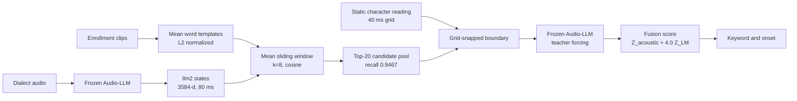

<p align="center">
  <a href="https://github.com/leeoisaboy/audiollm-latent-kws">
    
  </a>
</p>

<p align="center">
  <a href="README.md"></a>
  
  
  
</p>

# AudioLLM-Latent-KWS

**Training-free open-vocabulary dialect keyword search with frozen Audio-LLM latents.**

Smart-home and assisted-living devices keep meeting new dialect action commands. Collecting labels and fine-tuning a model for every new command puts the cost on the long tail. This project studies a more basic question. Does a frozen audio language model already contain enough acoustic and semantic information for a new word to be retrieved from a few enrollment clips.

The repository implements a reproducible two-stage pipeline. Stage 1 matches mean enrollment templates in an early Audio-LLM latent space and returns a Top-20 candidate pool. Stage 2 puts each candidate back into the frozen model with an aligned language context and reranks the pool by teacher forcing. All model parameters remain frozen. Static character timestamps are consumed as external input. The code keeps both the positive engineering result and the negative findings that constrain future work.

## Recommended configuration, up front

The early design treated `llm2 + C + Z_acoustic + 1.5 Z_LM` as fixed. The value `1.5` was inherited from an older experiment and was never selected on this corpus. It multiplies the language-model term, not the acoustic term; the acoustic coefficient is always one. The best measured combination supported by the current evidence is:

```text
llm2 · k=8 + mean centering · C + phonetic soft snap · Z_acoustic + 4.0 Z_LM · shape off
```

This combination reaches **0.5496 occurrence Top-1** and **0.6449 per-word Top-1** on the same candidate pool. Without the optional phonetic dependency, the repository default follows `C` at 0.5416 and 0.6258. The first number is the measured best point estimate; the second is the portable default.

| Stage | Current choice | Direct evidence |
| --- | --- | --- |
| Latent layer | `llm2`, 3584-d | Full-split Top-20 pool recall 0.9467; the only layer with full-split validation |
| Template and window | `k=8` plus enrollment mean centering | 0.9467 pool recall; +3.699 occurrence Top-1 points in speaker-disjoint nested CV |
| Left-context boundary | `C`, candidate-first-character grid snap | Prefix first-character pollution drops from 35.23% to 3.39%; C is 25.8 points above the wrong-sentence control X |
| Stage-2 extension | `C` plus phonetic soft snap | +0.801 point over recomputed C at `lambda_LM=4.0`, 95% CI [+0.345, +1.262] |
| Fusion weight | `Z_acoustic + 4.0 Z_LM` | Stable plateau 4.0 to 4.75; +1.850 points over `C@1.5` on the same recomputed runner, 95% CI [+1.183, +2.546] |
| Temporal shape | Disabled | -0.033 / -0.233 point in utterance / speaker nested CV at `lambda_LM=4.0`; both CIs cross zero |

Two quantities must be separated here. The acoustic branch is not weakened: the coefficient on `Z_acoustic` remains one. The values `1.5` and `4.0` describe how much relative weight the semantic term receives. In the same Stage-2 recomputation, setting `lambda_LM=0` keeps the acoustic term alone and gives 0.4399 occurrence Top-1. Setting `lambda_LM=4.0` raises it to 0.5416. Setting `lambda_LM=100`, which is effectively LM-only, falls to 0.5324. The acoustic term still contributes, but a weight of 1.5 underestimates the reranking contribution.

With one recomputed runner, `C` moves from 0.5311 at `1.5` to 0.5416 at `4.0`, and `C + phonetic` moves from 0.5358 to 0.5496. The best point estimate reaches **0.5496 occurrence Top-1** and **0.6449 per-word Top-1**.

| `lambda_LM` | C, occurrence | C, word | C + phonetic, occurrence | C + phonetic, word |
| ---: | ---: | ---: | ---: | ---: |
| 1.5, old default, unified recomputation | 0.5311 | 0.6182 | 0.5358 | 0.6286 |
| 2.0 | 0.5367 | 0.6218 | 0.5419 | 0.6358 |
| 3.0 | 0.5413 | 0.6289 | 0.5478 | 0.6456 |
| 4.0, current default | 0.5416 | 0.6258 | **0.5496** | **0.6449** |
| 4.75, sweep peak | 0.5432 | 0.6257 | 0.5499 | 0.6441 |

The `4.75` occurrence estimate is only 0.03 point above `4.0`, while its word-level value is slightly lower. The five utterance-grouped folds selected `4.75, 4.0, 4.75, 4.25, 4.75`; the speaker-grouped folds selected `4.75, 4.75, 4.0, 5.5, 4.0`. Both land on the 4.0 to 4.75 plateau. The repository therefore uses the more conservative `4.0` rather than presenting the sweep peak as a unique optimum. At the higher weight, naive P falls from 0.4538 to 0.4112 while C rises from 0.5311 to 0.5416. The more the semantic term matters, the more expensive a wrong prefix becomes.

### Why layer 0 is not the default yet

Layer 0 is the winner of the layer probe. On 24 occurrences and 64 multi-speaker templates, it reaches 1.0000 Top-20 recall and an inter/intra cosine ratio of 0.4828. `llm2` reaches 0.9583 and 0.5471. The better template separability of layer 0 is real.

| Candidate | Probe recall | Inter/intra | Full split | Current decision |
| --- | ---: | ---: | --- | --- |
| Layer 0 | **1.0000** | **0.4828** | Full features not exported | First experiment for the next revision |
| `llm2` | 0.9583 | 0.5471 | Top-20 recall 0.9467 | Current deployable default |

The full split currently covers only `llm1`, `llm2`, `llm6`, and their late fusion; it has no layer-0 result over 2031 utterances. Promoting a 24-occurrence probe to a full-corpus claim would overstate the evidence. The highest-value next experiment is therefore a full layer-0 export and a controlled rerun on the same candidate pool, not another fusion-weight sweep. The README keeps “probe winner” and “fully validated default” as separate claims. If the question is whether layer 0 separates templates better, the answer is yes. If the question is whether layer 0 is already a better deployable choice than `llm2`, the answer is not yet measured.

## Why this project exists

Dialect action words are sparse and unevenly distributed. A household may use only a handful of commands such as open the light, close the window, draw the curtain, or set the temperature. Pronunciations also vary across regions and speakers. Training a dedicated model for each home, dialect, and command does not scale.

Open-vocabulary keyword search offers another route. A device records a few examples of a target word and turns them into templates. At search time it locates those words directly in continuous speech. If early Audio-LLM latents are stable across speakers, adding a new word can avoid training. That hypothesis needs measurement.

Stage 2 exposes a second problem. The acoustic grid is about 80 ms per frame, while the external character reading grid is about 40 ms per frame. A direct conversion between the grids selects the wrong context boundary. The candidate first character then appears in the language-model prefix, so the model is asked to predict a token it has just seen. The error systematically lowers the score of a correctly localized candidate and is difficult to see from aggregate accuracy alone.

The project asks three questions.

1. Which frozen Audio-LLM layer gives the best cross-speaker keyword retrieval. An early acoustic layer should separate different words while keeping multiple takes of the same word close together.
2. How should the heterogeneous time grids be aligned. How large is prefix pollution under naive truncation, and can a training-free grid snap remove it.
3. Does the acoustic temporal shape of a keyword complement the language-model probability. A shape score may rank candidates on its own and still fail after fusion with the LM score.

## Key findings

| Question | Result | Consequence |
| --- | --- | --- |
| Which layer retrieves best | Layer 0 wins the probe on separability and recall; `llm2` is the only fully validated layer | Keep `llm2` for deployment and make layer 0 the next full-split experiment |
| Is `1.5` a good weight | It is an inherited value; at one runner, `4.0` adds 1.048 points and phonetic snapping adds another 0.801 | Default changes to `4.0`; report the 4.0 to 4.75 plateau |
| How much does grid alignment matter | Naive cuts pollute 35.23% of first characters, grid snapping 3.39% | Alignment matters more than most parameter tuning |
| Does temporal shape complement the LM | It ranks on its own; at `lambda_LM=4.0`, nested CV is -0.033 point with a CI crossing zero | Shape tie-breaking stays disabled |
| Can a small GPU reproduce the features | NF4 4-bit loading exported six layers on an RTX 4060 Laptop | The prototype runs on low-cost local hardware |

The two easy-to-misread rows are layer selection and fusion weight. Better inter-class geometry for layer 0 does not establish a full-split pool-recall win. Likewise, `1.5` is not a physical constant; it was an untuned historical value. This revision separates the two claims and moves them to “awaiting full validation” and “replaced by 4.0”, respectively.

## Method

<p align="center">
  
</p>
<p align="center"><sub>The mascot marks the candidates first; the language model checks the prefix second. Localization handles recall, and reranking orders the pool.</sub></p>



### Stage 1, acoustic latent localization

The frozen Audio-LLM produces audio-range hidden states at decoder block 2. Each frame has 3584 dimensions and advances by about 80 ms. For a word, each enrollment take is averaged over its keyword interval. The take means are averaged into a centroid and L2 normalized to form the template $q_w$.

Search computes cosine similarity for a mean window of length $k$.

$$
c_{i,w}=\frac{\bar h_{i,i+k-1}}{\lVert \bar h_{i,i+k-1}\rVert_2}\cdot q_w
$$

The word score is the maximum window response, and the corresponding window start is the coarse onset. The validated real-corpus setting uses `k=8` with enrollment mean centering. The best 20 words enter Stage 2. Pool recall is the hard ceiling for any later single-candidate decision.

### Stage 2, prefix-aligned language-model reranking

Each candidate is placed after the instruction, audio, and a left context. The frozen model returns the mean token log-probability.

$$
S_{\mathrm{LM}}(w)=\frac{1}{|\mathrm{tok}(w)|}\sum_t \log P\bigl(\mathrm{tok}(w)_t \mid \text{instruction},\text{audio},\text{prefix}_w,\mathrm{tok}(w)_{<t}\bigr)
$$

The default C arm finds the nearest occurrence of the candidate first character on the 40 ms reading grid and snaps the acoustic window start to that point. The prefix therefore ends before the first character. Acoustic and LM scores are normalized inside each candidate pool and fused with the validated LM weight of 4.0.

$$
\mathrm{Score}=Z_{\mathrm{acoustic}}+4.0\,Z_{\mathrm{LM}}
$$

## Experimental protocol

The main experiment uses Wu dialect data derived from WenetSpeech-Wu-Bench. It contains 2031 utterances, 3244 keyword occurrences, and 293 words. Features come from a frozen Step-Audio-2-mini checkpoint at `llm2`, with 3584 dimensions per frame and an 80 ms frame shift. The candidate pool is fixed at Top 20. Stage-2 uses an LM weight of 4.0, with a stability plateau from 4.0 to 4.75.

Results report occurrence Top-1 and per-word Top-1. Occurrence Top-1 weights every keyword occurrence equally. Per-word Top-1 averages within a word first, then across words. Cross-validation groups by utterance or by the `rec_sXX` session field. Window and calibration choices are made on training folds only. The `rec_sXX` grouping is a heuristic speaker proxy, not an official speaker annotation.

Synthetic fixtures verify code paths and never serve as accuracy evidence. The raw records for all reported numbers are in `docs/REAL_CORPUS_RESULTS.md` and `docs/layer_sweep.md`.

## Comparisons and results

### Stage 1, window, calibration, and template structure

| Configuration | Occurrence Top-1 | Word Top-1 | Top-20 recall |
| --- | ---: | ---: | ---: |
| `k=5` mean template, recomputed historical baseline | 0.4371 | 0.4821 | 0.9251 |
| `k=8` mean template | 0.4732 | 0.5523 | 0.9343 |
| `k=8` plus mean centering | **0.4741** | **0.5451** | **0.9467** |
| `k=8` plus ABTT | 0.3952 | 0.4506 | 0.8634 |
| `k=8` plus PCA whitening | 0.4319 | 0.4908 | 0.9097 |
| Duration-adaptive window | 0.4658 | 0.5412 | 0.9340 |
| 2-means multi-prototype and multi-scale | 0.4498 | 0.5142 | 0.9168 |

`k=8` plus mean centering is the only configuration in this set that gives a stable pool-recall gain. The speaker-disjoint nested CV gain is **3.699 percentage points** for occurrence Top-1, with a 95% CI of **[+2.796, +4.607]**. All five folds select this configuration. Utterance-grouped five-fold CV gives 3.514 points, with a 95% CI of [+2.624, +4.419].

ABTT, PCA whitening, duration adaptation, multi-prototype templates, and multi-scale search do not exceed this setting. The engineering priority shifts away from template complexity and toward the time grid and context alignment.

### Layer selection, small probe and full-split follow-up

The layer probe ran on an RTX 4060 Laptop with NF4 4-bit loading, double quantization, and bf16 compute. It contains 24 keyword occurrences and 64 multi-speaker enrollment templates. A layer number denotes a decoder block output, so layer 0 is the output of the first block.

| Layer | Top-20 recall | Inter-template cosine | Intra-template cosine | Inter/intra |
| ---: | ---: | ---: | ---: | ---: |
| 0 | 1.000000 | 0.446985 | 0.925754 | **0.482834** |
| 1 | 0.958333 | 0.513000 | 0.933310 | 0.549657 |
| 2 | 0.958333 | 0.511176 | 0.934279 | 0.547134 |
| 3 | 0.958333 | 0.528191 | 0.936630 | 0.563927 |
| 4 | 0.958333 | 0.549397 | 0.939740 | 0.584627 |
| 8 | 1.000000 | 0.602525 | 0.945296 | 0.637394 |

Layer 0 has full recall and the lowest inter/intra ratio on the small probe. Layer 8 also has full recall but the weakest template separation. Layer 2 loses one of the 24 occurrences and ranks behind layer 0 on both separability measures.

The full split later compared available late-fusion views.

| Layer view | Top-20 recall |
| --- | ---: |
| `llm1` | 0.9337 |
| `llm2` | **0.9467** |
| `llm1:0.5 + llm2:0.5` | 0.9414 |
| `llm1:0.3 + llm2:0.7` | 0.9436 |
| `llm2:0.7 + llm6:0.3` | 0.9396 |
| `llm1:0.5 + llm2:0.3 + llm6:0.2` | 0.9371 |

No existing layer-fusion view improves on `llm2`, which remains the default. This is not a claim that layer 2 beats layer 0; the two rows have different evidence levels. Layer 0 has only the 24-occurrence probe, while its 2031-utterance features have not been exported. The highest-value next experiment is a full layer-0 export and a controlled rerun on the same candidate pool.

### Seven-arm ablation, time-grid alignment

All seven arms share the same candidate pool, frozen model, and fusion weight. Only the left context changes. The table comes from an earlier public working point with a 0.9266 Top-20 pool recall. It is used for attribution of the alignment effect and should not be numerically mixed with the current 0.9467 baseline.

<p align="center">
  
</p>
<p align="center"><sub>Both clocks describe the same boundary. Snapping moves the cut point only; the frozen model and fusion weight stay unchanged.</sub></p>

| Arm | Left-context rule | Word Top-1 |
| --- | --- | ---: |
| A | No left context | 0.2233 |
| P | Cut the 40 ms reading at the 80 ms window start | 0.3591 |
| X | Use another utterance reading with the same cut point | 0.3597 |
| S | Use the acoustic Top-1 snap point for the whole utterance | 0.5457 |
| T | Truncate the gold transcript to the same length | 0.5763 |
| C | Snap to the candidate first-character grid position | **0.6172** |
| O | Use the gold sentence cut point | 0.6444 |

Arm P is almost identical to the wrong-sentence control X. The loss comes from misalignment, and arbitrary context does not repair it. Arm C exceeds X by **25.8 percentage points**. Arms T and O require transcripts or gold timestamps and are diagnostic ceilings only.

The pollution audit gives a direct explanation.

| Pollution measure | P, naive cut | C, grid snap |
| --- | ---: | ---: |
| Prefix contains the candidate first character | 0.3523 | 0.0339 |
| Prefix ends on the candidate first character | 0.3419 | 0.0173 |

About one third of P candidates see their own first character in the prefix. The causal model is then asked to predict a token that has already appeared, and a correctly localized candidate is penalized. Grid snapping reduces this form of pollution to about 3%.

### Stage 2, replication and extension branches

All 2031 utterances share one candidate pool. The table below is recomputed at `lambda_LM=4.0`; the historical public C at 1.5 is kept only as an older working point. Historical C and recomputed C still differ because of the runner, so that gap is not a new gain. The KV-cache path also has a value-parity audit.

| Branch at `lambda_LM=4.0` | Occurrence Top-1 | Word Top-1 | Against recomputed C |
| --- | ---: | ---: | ---: |
| P, naive cut | 0.4112 | 0.4308 | -13.04 points |
| C, recomputed with KV cache | 0.5416 | 0.6258 | 0 |
| **C plus phonetic soft snap** | **0.5496** | **0.6449** | **+0.801 point** |
| C plus Top-2 NMS starts | 0.5484 | 0.6383 | +0.678 point |
| C plus PMI, `gamma=0.25` | 0.5438 | 0.6278 | +0.216 point |
| Historical public C, `lambda_LM=1.5` | 0.5370 | 0.6266 | +0.59 point, runner difference |

Phonetic soft snapping gains **0.801 point** over recomputed C, with a 95% CI of **[+0.345, +1.262]**. It is the largest Stage-2 extension gain at weight 4.0 that improves both occurrence and word-level metrics with an interval above zero. It needs the optional `.[phonetic]` dependency and `--phonetic-snap` during `rerank`, so the core path remains C while the full recommendation enables it when available.

Top-2 NMS also becomes stable at 4.0, with a 95% CI of [+0.187, +1.175], but both point estimates trail phonetic snapping. PMI at `gamma=0.25` reaches only +0.216 point and `gamma=1.00` falls to 0.5071, so PMI remains outside the default path.

### Temporal shape, diagnostic signal and fusion failure

Shape arms convert candidate-window dynamics into a similarity score. Used alone, first-difference `d1` reaches 0.2132 occurrence Top-1, linear resampling reaches 0.4069, and subsequence DTW reaches 0.3633. DTW is not the strongest standalone arm, but it carries complementary information when the language model is uncertain.

| Base score | Shape signal | Grouping | Occurrence Top-1 change | 95% CI |
| --- | --- | --- | ---: | --- |
| LM-only | DTW gate | speaker 5-fold | **+0.832 point** | [+0.264, +1.449] |
| `acoustic + 1.5 LM` | All shape arms | utterance 5-fold | -0.333 point | [-0.605, -0.098] |
| `acoustic + 1.5 LM` | All shape arms | speaker 5-fold | -0.399 point | [-0.741, -0.068] |
| **`acoustic + 4.0 LM`** | **All shape arms** | **utterance 5-fold** | **-0.033 point** | **[-0.332, +0.268]** |
| **`acoustic + 4.0 LM`** | **All shape arms** | **speaker 5-fold** | **-0.233 point** | **[-0.533, +0.065]** |

DTW has a stable gain on the LM-only diagnostic baseline. After the acoustic term returns, the shape signal is negative at weight 1.5; at 4.0, nested utterance-grouped CV moves back to zero and speaker-grouped CV is -0.233 point with an interval that crosses zero. Neither grouping has a positive gain. The result indicates that local acoustic dynamics and global semantic probability occupy different distributions. A simple linear combination cannot cash in the standalone ranking ability.

Shape tie-breaking is therefore an audit operator and remains disabled by default. Any later attempt to use temporal information needs a new conditioning mechanism and a separate held-out evaluation.

### KV cache and low-cost inference

The cached path encodes the audio prefix once and decodes candidates incrementally from a shared prefix. On an H20 with 20 candidates, fp16, and five warm runs, the median speed-up is **1.30x to 2.14x**. The gain is modest because candidate strings are usually one to four tokens and the baseline already batches equal-length candidates.

In a 200-utterance parity audit, the largest score difference is 0.0391 to 0.0469 nats and the minimum Spearman correlation is 0.997. C-arm Top-1 agrees on 199 of 200 utterances, and all four reported metrics are identical. The project does not claim a 5x to 10x speed-up or an 80% memory reduction.

Feature export can write layers `0,1,2,3,4,8` in one forward pass. A 5 GB class GPU can run base feature extraction with NF4 4-bit loading, double quantization, and fp16 compute. The public 4-bit runner targets the base extractor. Adapter merging uses the unquantized model path.

## What the prototype is useful for

The first contribution is a reproducible baseline. Open-vocabulary dialect KWS often hides enrollment, localization, LM reranking, and threshold calibration inside one black box. This repository separates the stages and reports pool recall, within-pool Top-1, prefix pollution, and cache parity independently. A researcher can replace one stage while keeping the other controls.

The second contribution is an alignment diagnostic. Heterogeneous time grids are common in cascaded systems. The project provides a measurable pollution criterion and a set of arms that change only the left context. The 25.8-point gap between C and X shows that context placement can decide whether reranking works.

The third contribution is a reusable negative result. PMI, ABTT, PCA whitening, multi-prototype templates, existing layer fusion, and fixed-weight temporal shape were all tested on the real corpus. Apart from phonetic snapping, these extensions stay out of the recommended path; Top-2 NMS becomes positive at weight 4.0 but still trails phonetic snapping. Later work can avoid those directions or design a targeted experiment around the failure mechanism.

As an engineering prototype, the system shows a local enrollment and search path. A device needs only a few target-word recordings. Templates and latents can be produced locally, and the model does not update. It is a research baseline for dialect commands in smart-home and assisted-living devices. Production wake-word use still needs far-field robustness, false-accept measurement, real-time latency, power, rejection behavior, and independent evaluation across more dialects.

## Known limits

- The main experiment covers one 2031-utterance Wu dialect corpus and does not establish cross-dialect generalization.
- Speaker groups come from the heuristic `rec_sXX` field rather than verified official speaker IDs.
- The 4-bit layer sweep contains only 24 occurrences. It proposes candidate layers and does not replace a full evaluation.
- The layer-0 advantage comes from a 24-occurrence probe. Full layer-0 features have not been exported, so it is not yet a full-corpus optimum.
- Phonetic snapping gains 0.801 point over recomputed C at `lambda_LM=4.0`, but it is validated on one corpus and needs an independent second corpus.
- The 4.0 to 4.75 plateau is selected on this corpus; the weight still needs external cross-corpus validation.
- PMI, ABTT, PCA whitening, multi-prototype templates, and existing layer-fusion views have no stable real-corpus net gain. Top-2 NMS is positive at 4.0 but below phonetic snapping.
- Shape tie-breaking has no positive gain at `lambda_LM=4.0` and remains disabled.
- This repository is a research prototype, not a production wake-word system.

## Repository map

| Path | Responsibility |
| --- | --- |
| `locator/` | Stage 1 templates, sliding-window cosine search, pools, and optional calibration |
| `reranker/` | Stage 2 reading-grid snapping, left-context construction, and teacher-forcing scores |
| `analysis/` | Prefix pollution audit, layer comparison, shape operators, and non-decision tools |
| `integration/` | Step-Audio-2 feature export and low-VRAM loading adapters |
| `scripts/` | Real-corpus ablations, cross-validation, layer fusion, and cache benchmarks |
| `data/` | Public schemas, neutral examples, and deterministic synthetic fixtures |
| `docs/` | Architecture, reproduction checklist, model notes, and real-corpus results |
| `tests/` | Unit tests for localization, alignment, scoring, shape, and model-loading guards |

## Quick start

```bash
git clone https://github.com/leeoisaboy/audiollm-latent-kws.git
cd audiollm-latent-kws
python -m venv .venv
python -m pip install -e ".[dev]"
python scripts/make_fixtures.py --output data/synthetic
```

Run the complete flow on synthetic fixtures. These scores only verify that the interfaces connect.

```bash
python cli.py locate \
  --templates data/synthetic/templates.jsonl \
  --enroll-dir data/synthetic/enroll \
  --search-manifest data/synthetic/search_manifest.jsonl \
  --search-dir data/synthetic/search \
  --latent-width 16 \
  --window 8 \
  --whitening center \
  --pool-top 20 \
  --include-gold \
  --output reports/pool.jsonl

python cli.py evaluate \
  --pool reports/pool.jsonl \
  --pool-top 20 \
  --output reports/stage1.json

python cli.py rerank \
  --pool reports/pool.jsonl \
  --reading data/synthetic/readings.jsonl \
  --wav-dir data/synthetic \
  --scorer examples.dummy_scorer:create_scorer \
  --variants A,P,X,S,C \
  --null-shift 1 \
  --output reports/lm.jsonl

python cli.py fuse \
  --pool reports/pool.jsonl \
  --lm reports/lm.jsonl \
  --variant C \
  --lambda-lm 4.0 \
  --output reports/metrics.json

python cli.py audit \
  --pool reports/pool.jsonl \
  --lm reports/lm.jsonl \
  --reading data/synthetic/readings.jsonl \
  --null-shift 1 \
  --output reports/prefix_audit.json
```

After `python -m pip install -e ".[phonetic]"`, add `--phonetic-snap` to the `rerank` command to enable the phonetic branch of the recommended combination.

Real feature extraction needs a private audio manifest and a frozen model. The following command exports six layers in one pass.

Install the optional runtime first with `python -m pip install -e ".[stepaudio2]"`.

```bash
python integration/step_audio2.py \
  --model /path/to/Step-Audio-2-mini \
  --manifest /private/path/all_clips.jsonl \
  --enroll-manifest /private/path/enroll_manifest.jsonl \
  --search-manifest /private/path/search_manifest.jsonl \
  --output-root features \
  --layers 0,1,2,3,4,8 \
  --quantization 4bit \
  --dtype float16 \
  --min-duration 0.32 \
  --max-duration 12.0
```

Compare the exported layers with the command below.

```bash
python cli.py compare-layers \
  --features-root features \
  --templates data/reference/templates.jsonl \
  --search-manifest data/dialect_kws_testset/manifest.jsonl \
  --layers 0,1,2,3,4,8 \
  --latent-width 3584 \
  --pool-top 20 \
  --output reports/layer_comparison.json
```

Reranking requires a private runner that implements `AudioLMScorer`. The public repository contains no model weights, restricted audio, speaker identities, or recognizer output.

## Data and models

Public examples use neutral household commands such as turn on the light, close the window, draw the curtain, and set the temperature. Real audio, enrollment manifests, character timestamps, derived latents, and evaluation reports belong in a private environment and remain subject to their source licenses.

The Wu resource index is [WenetSpeech-Wu](https://huggingface.co/datasets/ASLP-lab/WenetSpeech-Wu). Public model and adapter loading constraints are documented in [docs/MODELS.md](docs/MODELS.md). The repository distributes neither weights nor corpus audio.

## Reproduction and tests

```bash
python -m compileall -q .
python -m pytest -q
```

See [docs/REPRODUCE.md](docs/REPRODUCE.md) for the full checklist, [docs/REAL_CORPUS_RESULTS.md](docs/REAL_CORPUS_RESULTS.md) for real-corpus numbers, and [docs/layer_sweep.md](docs/layer_sweep.md) for the layer sweep.

The code is released under Apache-2.0. Data, models, and derived features retain their original licenses. The example files are not redistributable corpus data.

**The most useful output of this project is a frozen Audio-LLM keyword-search baseline that explains both its successes and its failures.**
