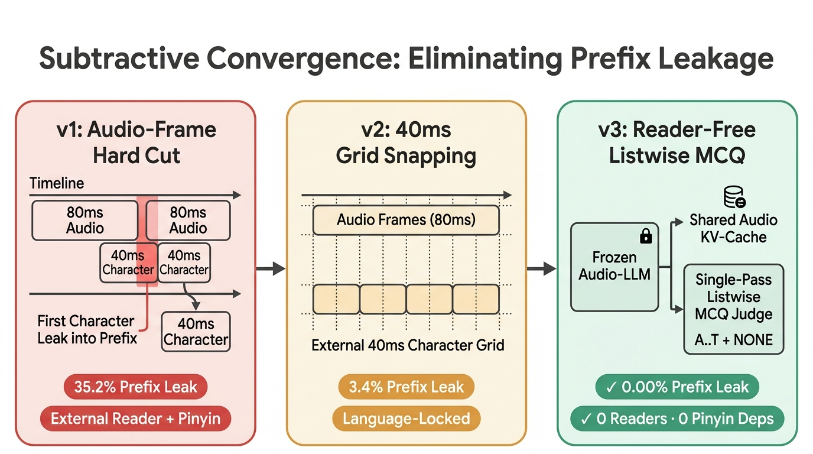
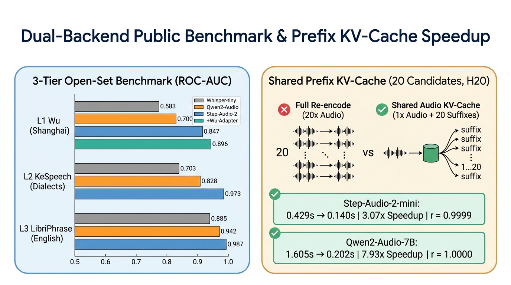
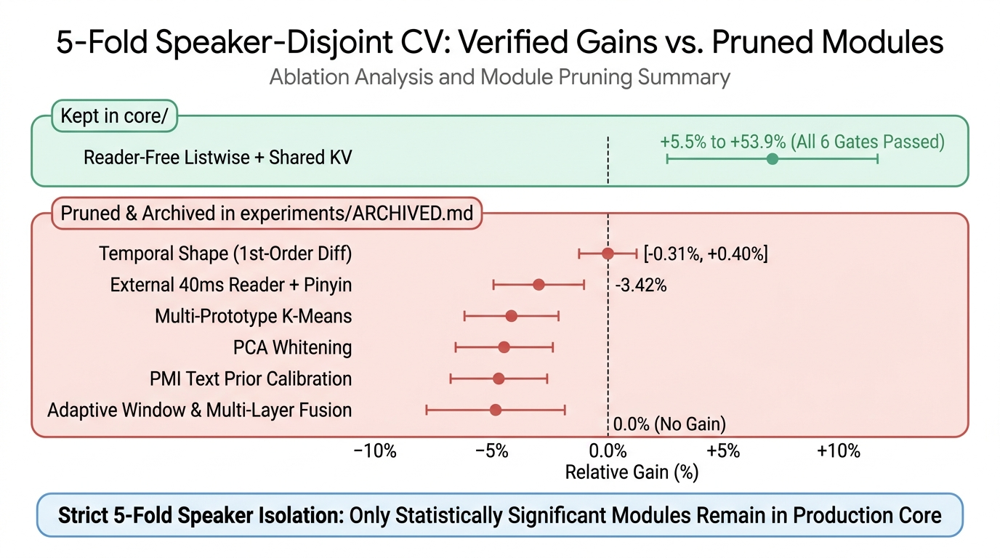
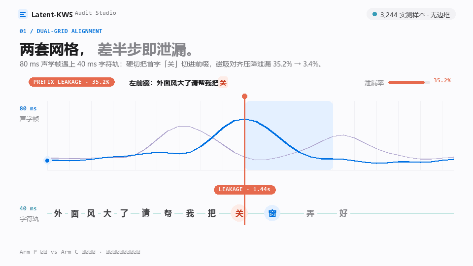

<p align="center">
  <a href="https://github.com/leeoisaboy/audiollm-latent-kws">
    
  </a>
</p>

<p align="center">
  <a href="README.en.md"></a>
  <a href="https://leeoisaboy.github.io/audiollm-latent-kws/"></a>
  <a href="https://huggingface.co/datasets/Leeoisaboy/audiollm-latent-kws-bench"></a>
  <a href="https://leeoisaboy.github.io/disentangle-acoustic-print/"></a>
  
  
</p>

<h1 align="center">AudioLLM-Latent-KWS</h1>

<p align="center"><strong>给音频大模型做减法，让它录两遍新词就能跨语种听懂。</strong></p>

<p align="center">
  
  <br />
  <sub>图 1：AudioLLM-Latent-KWS 语言无关五步流水线与双后端公开基准架构</sub>
</p>

让语音设备听懂一个从未学过的新词，比如一句地方方言的求助口号，或者用户随口定下的自定义唤醒词，传统做法往往要走一条很重的路。先找人录上几百上千遍音频，再拿显卡重新训练模型，耗时又费钱。

上个月我开源过一个研究原型，想验证一条更轻的路子。把现成的语音大模型冻住，一行参数都不改，只让用户把新词念一两遍录下来，模型能不能立刻在后续对话里把它找出来。

上一版原型在私有吴语语料上跑通了，身上却挂着不少累赘。它依赖一个外部字符阅读器做时间对齐，绑死了普通话拼音库 `pypinyin`，还把模型层位和切片宽度写死在代码里。外人既不好复现，也很难把它搬到别的方言或外语上。

这一版更新，我把重点放在了做减法、拆依赖和公开验收上。整套系统被收拢成一个不挑语种的五步检索引擎，在沪语、全国多方言和英文三套公开考卷上，用两款完全不同的开源冻结语音大模型完成了全量实测。

## 一、做架构减法，把「提前泄题」降到零

这套方案分两步找词，和人听录音找关键词的直觉很像。第一步先快速扫一遍整段音频，圈出最像目标词的 20 个嫌疑候选；第二步再结合上下文，把这 20 个候选重新排一遍队，挑出真正的答案，或者确认整句话里压根没有目标词。

旧版系统卡在第二步的切分方式上。当时为了给大模型提供前文语境，我在外面挂了一个 40 毫秒一格的字符阅读器，可底层音频特征是 80 毫秒一格。两套时钟对不齐，直接按音频格子硬切，有 35.2% 的情况会把目标词的第一个字切进前文里。这就好比考试时不小心把答案的首字印在了题干上，模型看着像是考了高分，其实是开了卷。后来改用向 40 毫秒字符网格对齐的办法，泄题率降到了 3.4%，但系统还是得拖着外部阅读器和普通话拼音库一起跑，换个语种就瘫痪。

这一版索性把外部阅读器和拼音库全部撤掉。核心代码包 [`core/`](core/) 经过 AST 静态代码审计，已经做到零语种绑定、零拼音依赖。

<p align="center">
  
  <br />
  <sub>图 2：从音频硬切（35.2% 泄题）、网格对齐（3.4% 泄题）到无阅读器多选题重排（0.00% 泄题）的架构收敛过程</sub>
</p>

去掉外部字符轨以后，第二步改成了「共享音频记忆 + 多选题」的考法。模型直接听同一段音频缓存，眼前摆着 20 个候选词，外加一个「以上都不是（`NONE`）」的拒识选项。模型一次性做完判断，不再需要切分和拼接外部文字，前文泄题率降到了 0.00%，遇到没有关键词的日常闲聊也能老实拒绝。

整条核心流程现在只剩五个纯函数：`enroll`（注册样音）、`locate`（浅层粗定位）、`safe_prefix_cut`（安全截断）、`kv_rerank`（共享缓存重排）和 `threshold`（开放集拒识门槛）。注册阶段不再写死 8 帧，改为按样音的中位时长自动换算窗口，做出归一化的声音模板。粗定位阶段在模型的浅层隐空间里做滑窗相似度匹配，拿到 Top-20 候选池。重排阶段再把候选正反序各排一次消除位置偏见，把声学分和语言分在池内标准化后融合，最后过一道拒识门槛。

为了不绑死某一家模型，我在 [`integration/backend.py`](integration/backend.py) 里把底层接口压到了只剩三个方法，分别负责提取浅层声音特征（`extract_shallow`）、预存音频记忆（`prefill_prefix_kv`）以及给候选词打分（`score_suffixes`）。目前已经同时跑通了 `Step-Audio-2-mini`（80 毫秒/帧）和 `Qwen2-Audio-7B-Instruct`（40 毫秒/帧）两款结构不同的开源模型。

## 二、把考卷和门槛全部公开

关起门来测私有数据，说服力有限。而且现实里的语音识别每天要听大量无关对话，如果考卷里只有包含关键词的正例，就测不出系统平时会不会乱报警。

这次我把预切分好的三级公开评测集直接传到了 Hugging Face 仓库 **[Leeoisaboy/audiollm-latent-kws-bench](https://huggingface.co/datasets/Leeoisaboy/audiollm-latent-kws-bench)**。每一级考卷都包含 40 个目标词、120 条注册样音、180 条带词正例和 180 条不含目标词的负例，并且严格执行说话人隔离，确保同一个人的声音绝不同时出现在注册样音和测试集里，防止模型靠认人声音色蒙混过关。

- **L1 沪语日常口语**：取自 `Shanghai_Dialect_Conversational_Speech_Corpus`，包含 14 位说话人，用来检验低资源吴语的同语族复现。
- **L2 跨汉语方言**：取自 `KeSpeech` 多方言测试集，包含 96 位说话人，检验跨方言迁移能力。
- **L3 英文开放集**：取自 `LibriPhrase` 英文短语集，包含 160 位说话人，负例按一半容易混淆的难负例、一半普通负例配比，检验跨语种泛化能力。

评价指标也从单一的排第一准确率（Top-1），补全到了更贴近真实落地的开放集口径。除了看前 20 名候选池有没有把真词捞进来（R@20），还加入了开放集区分度 `ROC-AUC`（衡量把真触发和假警报分开的整体能力，满分是 1）和 `Recall@5%FAR`（把误报率死死卡在 5% 以内时，还能抓住多少真正的关键词）。仓库里的 [`analysis/gates.py`](analysis/gates.py) 写死了六项硬性发布门禁，涵盖召回底线、重排净提升、零泄题和加速一致性，全部绿灯才算过关。

## 三、H20 双后端实测与缓存加速

在单张 NVIDIA H20 显卡、fp16 精度和 0.00% 前文泄题的条件下，我把两套冻结语音大模型和传统的 `Whisper-tiny` 语音转文字模糊检索基线拉到同一张考卷上做了对比。

这里有一个容易踩空的工程细节。把 `Step-Audio-2` 好用的第 2 层照搬到 `Qwen2-Audio` 上，初筛召回并不理想。把 `Qwen2-Audio` 的 11 层全部扫了一遍才发现，最适合找声音相似度的位置在它双向 `audio_tower` 的输出端（`layer=-2`），那里保留着最完整的原始声学信息，还没有被后面的文本因果预测覆盖。切到这一层之后，`Qwen2-Audio` 在三级公开集上的 Top-20 召回直接抬高了 22.8 到 42.5 个百分点，两套异构模型在 L1、L2、L3 上全部跨过了 85% 的召回底线。

三套公开考卷的核心对比数据整理如下。

| 评测层级 | 模型方案 | R@20 召回 | 最终 Top-1 | 开放集 AUC | Recall@5%FAR | 单句耗时 |
| --- | --- | ---: | ---: | ---: | ---: | ---: |
| L1 沪语 | Whisper-tiny 基线 | — | 3.3% | 0.583 | 4.4% | 0.697s |
| L1 沪语 | Qwen2-Audio (`layer=-2`) | 87.7% | 26.7% | 0.700 | 16.7% | 0.168s |
| L1 沪语 | **Step-Audio-2 (`layer=2`)** | **96.2%** | **40.4%** | **0.847** | **31.7%** | **0.124s** |
| L2 多方言 | Whisper-tiny 基线 | — | 44.4% | 0.703 | 40.0% | 0.125s |
| L2 多方言 | Qwen2-Audio (`layer=-2`) | 94.4% | 61.7% | 0.828 | 50.6% | 0.174s |
| L2 多方言 | **Step-Audio-2 (`layer=2`)** | **99.1%** | **72.4%** | **0.973** | **90.6%** | **0.121s** |
| L3 英文 | Whisper-tiny 基线 | — | 73.9% | 0.885 | 73.3% | 0.160s |
| L3 英文 | Qwen2-Audio (`layer=-2`) | 97.8% | 90.6% | 0.942 | 57.2% | 0.151s |
| L3 英文 | **Step-Audio-2 (`layer=2`)** | **100.0%** | **97.8%** | **0.987** | **91.7%** | **0.114s** |

读表的时候有两处值得留意。第一处是 L3 英文集上 `Qwen2-Audio` 的重排涨幅，它第一阶段只靠声音相似度排第一的准确率只有 36.7%，经过共享音频缓存的多选题重排后直接拉到了 90.6%，净涨 53.89 个百分点（95% 置信区间为 45.76 到 62.01 个百分点）。`Step-Audio-2` 在 L1 沪语上的重排同样带来了 5.48 个百分点的净提升（95% 置信区间 2.63 到 8.43 个百分点）。

第二处是 L1 沪语表里的 40.4% 看起来偏低，其实藏着一个统计口径陷阱。沪语日常口语里，有 35% 的句子同时包含了 2 到 7 个目标词。如果套用「一句只许选一个赢家」的传统出现级 Top-1 算分，就算模型一个都不错，数学上的绝对满分天花板也只有 180 除以 292，也就是 61.6%。换成更贴合口语现实的句级命中率（`Utt-Hit@1`）后，裸底座模型配合 3 段时序金字塔和两两比对能做到 61.7%；如果再接上公开吴语适配器（`Wu-ASR` 浅层配合 `Wu-Und` 顶层多选），指标会进一步升到 99.3% 的 R@20、72.2% 的句级命中、93.9% 的前五命中、73.9% 的 Macro-F1 以及 0.896 的 AUC。完整明细都放在了 [`docs/CONVERGENCE_RESULTS.md`](docs/CONVERGENCE_RESULTS.md)。

<p align="center">
  
  <br />
  <sub>图 3：左侧为三级公开基准的开放集 ROC-AUC 对比，右侧为 20 候选共享音频 KV-Cache 的实测加速比与打分一致性</sub>
</p>

速度上的瓶颈则靠共享音频前缀缓存（Prefix KV-Cache）解开。过去给 20 个候选词打分，模型要把整段输入音频从头到尾重听 20 遍；改成共享前缀缓存以后，音频只需要听 1 遍并把内部状态存下来，后面 20 个候选词直接复用这份记忆做判断。

加速固然好，前提是算出来的分数不能走样。门禁要求复用缓存和从头重算的打分相关系数至少达到 0.995，实测加速比至少大于 1.3 倍。

| 冻结模型后端 | 20 候选全序列重算 | 共享音频前缀缓存 | 实测加速比 | Pearson / Spearman 相关性 | 最大分数误差 |
| --- | ---: | ---: | ---: | ---: | ---: |
| `Step-Audio-2-mini` | 0.429s | 0.140s | **3.07 倍** | 0.99993 / 0.99992 | 0.032 nats |
| `Qwen2-Audio-7B-Instruct` | 1.605s | 0.202s | **7.93 倍** | 1.00000 / 1.00000 | 0.011 nats |

两套模型都以几乎无损的打分一致性通过了验收，在 H20 上把 20 候选重排的耗时拉进了两百毫秒以内。

## 四、诚实归档，被我剪掉的七项阴性实验

做预研的时候，很容易陷入一种惯性，觉得多加一个听起来很聪明的算法模块，效果总该更好一点。可一旦把这些模块放进严格按说话人分组的五折交叉验证里盲测，不少直觉上的好主意都会露馅。

这次重构，我把所有没跑赢基线、或者 95% 置信区间跨过零点（意味着那点提升大概率只是随机运气）的七个实验分支，全部从 `pyproject.toml` 的主包里剥离了出来，统一写进 [`experiments/ARCHIVED.md`](experiments/ARCHIVED.md) 供后来者避坑。

- **外部 40 毫秒字符阅读器与拼音近似对齐**：在公开 L1 基准上正面比对无阅读器方案，不仅引入了沉重的外部依赖和语种锁死，重排表现还倒跌了 3.42 个百分点，而无阅读器方案净涨了 10.62 个百分点。
- **时序形状加权（一阶差分）**：原本希望捕捉发音动态变化，五折验证的 95% 置信区间落在 -0.31 到 +0.40 个百分点之间，跨过零点，没有稳定增益。关于声学轨迹解耦的独立探索，我另开了姐妹仓库 [disentangle-acoustic-print](https://github.com/leeoisaboy/disentangle-acoustic-print) 单独推进。
- **多原型 K-means、PCA 白化、PMI 文本先验校准、自适应扩展窗、多层分数融合**：这五项单看原理都很合理，但在跨说话人盲测中全部出现掉分或增益跨零，一律移出了默认链路。

<p align="center">
  
  <br />
  <sub>图 4：严格说话人隔离下的五折交叉验证森林图，仅统计学上稳定为正的核心方案保留在 core/ 主包中</sub>
</p>

在工程底座里，剪掉一个无效模块的长期收益，往往比塞进三个花哨模块高得多。代码变薄了，出错面变小了，复现的人也少踩一遍我踩过的坑。

## 五、白盒审计台与当前边界

为了让结果不只躺在几张静态表格里，我顺手在仓库的 [`studio/`](studio/) 目录下做了一个零后端的网页审计台 **[Latent-KWS Audit Studio](https://leeoisaboy.github.io/audiollm-latent-kws/)**，直接托管在 GitHub Pages 上，也可以在本地一键起个静态服务打开：

<p align="center">
  <a href="https://leeoisaboy.github.io/audiollm-latent-kws/">
    
  </a>
</p>

<p align="center"><strong><a href="https://leeoisaboy.github.io/audiollm-latent-kws/">▶ 进入在线 Latent-KWS Audit Studio</a></strong></p>

页面按长卷轴排了五个模块，分别是三级公开基准与六项门禁看板、减法消融与零泄题对照、两阶段重排与开放集拒识、双后端缓存加速竞赛，以及五折交叉验证森林图。右上角支持直接拖入本地跑出来的 `pool.jsonl` 和 `lm.jsonl`，所有统计都在浏览器本地内存里完成，零数据上传，方便把任意一条样本拆开看它的打分明细。

仓库目前的目录分工很干净：`core/` 装不挑语种的五步纯函数引擎，`integration/` 装三方法后端抽象和双模型接入，`analysis/` 装开放集指标、五折统计和六项门禁，`scripts/` 提供一键复现脚本，`tests/` 里有 26 个全部通过的单元测试，覆盖五步主链路、AST 零语种依赖审计和门禁断言。

```bash
git clone https://github.com/leeoisaboy/audiollm-latent-kws.git
cd audiollm-latent-kws
python -m venv .venv
python -m pip install -e ".[dev]"
pytest -q

# 本地零依赖预览白盒审计台
python -m http.server 8766 --directory studio
```

最后照例把边界交代清楚。这份仓库公开的是免训练关键词检索的核心算法、公开评测基准和工程加速验证，回答的是冻结音频大模型在不微调的前提下，跨方言和跨语种检索到底能做到哪一步。真要装到硬件设备里，面对远场强噪声、低功耗常驻监听以及端到端流式延迟，还需要结合具体的端云协同架构继续攻关。

- **项目地址**：[AudioLLM-Latent-KWS](https://github.com/leeoisaboy/audiollm-latent-kws)
- **在线审计台**：https://leeoisaboy.github.io/audiollm-latent-kws/
- **公开评测集**：https://huggingface.co/datasets/Leeoisaboy/audiollm-latent-kws-bench

**把多余的耦合剪干净，真正站得住的能力才会显形。**
