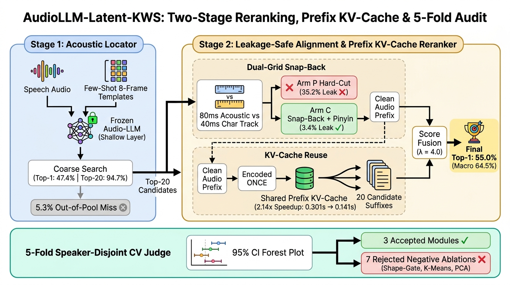
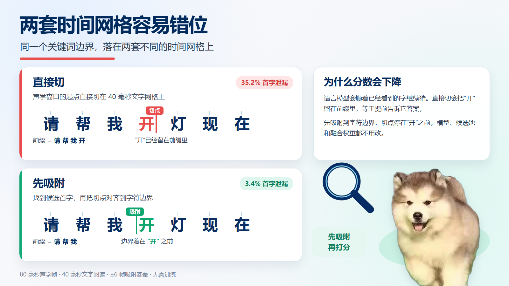

<p align="center">
  <a href="https://github.com/leeoisaboy/audiollm-latent-kws">
    
  </a>
</p>

<p align="center">
  <a href="README.en.md"></a>
  <a href="https://leeoisaboy.github.io/audiollm-latent-kws/"></a>
  <a href="https://leeoisaboy.github.io/disentangle-acoustic-print/"></a>
  
  
</p>

<h1 align="center">AudioLLM-Latent-KWS</h1>

<p align="center"><strong>只录几段方言词，就能让冻结的音频大模型听懂新指令；把召回、泄漏与 7 项失败实验全部摊开在光下。</strong></p>


## 方法流程图 · Architecture Pipeline

<p align="center">
  
</p>

## 正在运行的审计台

<p align="center">
  <a href="https://leeoisaboy.github.io/audiollm-latent-kws/">
    
  </a>
</p>

<p align="center"><strong><a href="https://leeoisaboy.github.io/audiollm-latent-kws/">▶ 进入在线 Latent-KWS Audit Studio</a></strong></p>

这段动图直接还原了在线审计台的四个动态模块。整个页面采用无边框浅色长卷轴设计，随滚动自动渐入渐出，无需鼠标悬停也会自己演进：你可以直观看到 80 ms 与 40 ms 两套时间网格错位如何导致「偷看答案」、权重 `λ` 如何把方言词从第 4 名送到第 1 名、共享音频前缀缓存为何快了 2.14 倍，以及五折交叉验证如何诚实砍掉 7 项听起来很美却没有收益的改动。页面右上角还支持直接拖入你本地跑出来的 `pool.jsonl`、`lm.jsonl` 和 `readings.jsonl`，纯浏览器内存解析，数据绝不上传。

| 模块 | 页面里你能看到什么 | 对应代码 / 证据 |
| --- | --- | --- |
| 01 双网格对齐 | 80 ms 声学响应曲线 vs 40 ms 字符轨；Arm P 硬切泄漏（35.2%）与 Arm C 磁吸回退（3.4%） | `reranker/align.py`、`reports/prefix_audit_real.json` |
| 02 两阶段重排 | Top-20 声学候选 → 语境融合排名升降机，含 5.3% 池外诚实失败例 | `locator/search.py`、`reports/stage2_lambda_sweep.json` |
| 03 前缀缓存 | 20 路全序列重算（0.301 s）vs 共享前缀 KV 复用（0.141 s，2.14× 加速） | `integration/step_audio2.py`、`reports/cache_benchmark.json` |
| 04 五折裁判台 | 95% 置信区间森林图：3 项通过启用 vs 4 类典型淘汰实验（附姐妹项目互链） | `reports/stage1_cv_speaker.json`、`shape_gate_cv_fused_l4_speaker.json` |

## 为什么做这个项目

很多语音设备已经能听懂普通话，但一遇到吴语等方言里的细分说法就容易抓瞎。每加一个新词，如果都要重新找人录大批数据、标时间戳、再微调大模型，成本会高得不切实际。

这个项目想回答一个很朴素的问题：**如果大模型参数完全冻住不动，只靠用户新录的几段方言样本，模型内部已经算出来的声音特征，够不够把新词找出来？**

我们没有试图把它包装成“高精度商用唤醒词”，而是做了一套**完全可复现、不藏失败的白盒研究基线**。除了给出 94.7% 候选召回与 55.0% 最终 Top-1 的真实水平，更把两类工程里最容易踩的坑摊开讲透：
1. **两套时间网格对不齐，模型其实在「偷看答案」**；
2. **很多直觉上很合理的加分模块，上了严格的五折交叉验证反而没用甚至掉分**。

## 一步步看懂它怎么工作

整个流程不训练、不改模型权重，只分两步走：

1. **第一步：先用声音撒一张网（声学粗定位）**
   把用户的几段注册录音提取成冻结大模型第 2 层的平均声学模板，再扣除注册集的整体背景偏移（去均值）。遇到新语音时，用 8 帧（640 ms）滑窗扫过整句话，把最像的 **20 个候选词**先捞进池子里。
2. **第二步：再结合前文一锤定音（语境精排）**
   单听一小段声音，吴语快读下的「关窗」和「开灯」可能很接近。所以把这 20 个候选放回冻结的音频大模型，结合这句话前面的文字（例如「外面风大了请帮我把 ___」）重新打分，按 `声学分 + 4.0 × 语境分` 排定最终第一名。

### 关键细节：为什么必须做「双网格磁吸对齐」？

音频模型每 **80 毫秒**吐出一帧，外部文字阅读器每 **40 毫秒**落一个字。两套刻度并不重合。如果直接按最近声学帧一刀硬切，切点很容易落在目标词首字之后——结果把「关」字切进了左侧前缀，相当于提前把答案漏给了大模型。

<p align="center">
  
</p>

在 3,244 次真实目标词上做完检查后，差距触目惊心：

| 上下文切法 | 前缀里混进目标词首字的比例 | 直观含义 |
| --- | ---: | --- |
| 按最近帧硬切（Arm P） | **35.2%** | 超过三分之一的样本在“偷看答案” |
| 先吸附到 40 ms 字符边界（Arm C） | **3.4%** | 泄漏直接压降到原来的十分之一 |
| 再加拼音近似（C + Pinyin） | **进一步修补同音错字** | 就算阅读器把「关窗」写错成「官窗」，切刀也能按同音回退（+0.80 pp） |

## 真实数据怎么说

以下全部数字来自 **2,031 条吴语真实语音、3,244 次目标词出现、293 个词**的完整实测（详见 [reports/README.md](reports/README.md)）：

| 大家最关心的问题 | 实测结果 | 通俗解读 |
| --- | ---: | --- |
| 正确词有没有进入前 20 候选？ | **94.7%** | 3,244 次中捞进了 3,071 次；剩下 5.3% 没进池，后级重排再强也救不回来 |
| 只靠声音粗找，排第 1 的比例？ | **47.4%** | 1,538 次直接命中第一 |
| 加上语境重排（默认 λ=4.0）？ | **54.2%** | 1,757 次排第一，无需额外安装拼音库 |
| 再加可选拼音近似吸附？ | **55.0%** | 1,783 次排第一（词级均衡 64.5%），为推荐组合 |

### 工程提速：Prefix KV-Cache 复用

给 20 个候选词打分时，前面的系统提示词和整段音频完全一样。只算一次前缀并缓存 KV，再同时跑 20 个极短的候选词分支，在 **NVIDIA H20（fp16）** 上实测结果如下：

| 音频长度 | 全序列重算 20 次 | 共享前缀 KV 复用 | 实测加速 | 额外峰值显存 |
| --- | ---: | ---: | ---: | ---: |
| 1.0 秒 | 0.283 s | 0.160 s | **1.77×** | 174 → 154 MB |
| 3.6 秒 | 0.239 s | 0.183 s | **1.30×** | 127 → 123 MB |
| 6.4 秒 | 0.301 s | 0.141 s | **2.14×** | 192 → 163 MB |

在 200 条对照语音上，复用缓存与全序列重算的排序相关性 **r ≥ 0.997**，**199/200** 条语音的最终答案完全一致。

## 7 项没进默认路径的「阴性实验」

很多项目只报喜不报忧，但我们把所有跑过却**没通过五折交叉验证**的方案全部保留了代码和报告，供同行避坑：

| 尝试过的直觉方案 | 真实语料表现 | 为什么默认关闭 |
| --- | --- | --- |
| **时序形状加权（一阶差分）** | +0.03 pp（95% 区间 `[-0.31, +0.40]`） | 区间跨零无稳定收益。单看时序形状确实有独立解耦能力（见姐妹项目 [disentangle-acoustic-print](https://github.com/leeoisaboy/disentangle-acoustic-print)），但在强 LM 重排后固定相加不再加分 |
| **多原型子模板（K-means）** | Top-1 45.0% / 召回 91.7% | 小样本注册下强拆多模板容易过拟合，明显弱于单均值 8 帧模板（47.4% / 94.7%） |
| **PCA 去主成分 / 白化** | Top-1 39.5% / 43.2% | 粗暴白化破坏了浅层隐空间里与方言音素强相关的主方差方向 |
| **文本先验校准（PMI）** | λ=4.0 下 **-3.45 pp** | 扣除无音频先验反而压制了常见合法指令的真实语境概率 |
| **自适应扩展窗口** | Top-1 46.5% / 召回 93.4% | 不如固定 8 帧（640 ms）滑窗稳定 |
| **多层分数融合** | 召回 94.7% → 93.4% | 牺牲了最关键的候选池上限 |
| **单候选保留双起点** | +0.68 pp | 收益弱于更轻量的拼音近似吸附 |

## 快速体验与本地运行

### 1. 直接在浏览器里体验 Audit Studio
在线访问 **[Latent-KWS Audit Studio](https://leeoisaboy.github.io/audiollm-latent-kws/)**，或本地零依赖启动静态页面：

```bash
python -m http.server 8766 --directory studio
```

### 2. 用合成数据 1 分钟跑通完整命令行流程

```bash
git clone https://github.com/leeoisaboy/audiollm-latent-kws.git
cd audiollm-latent-kws
python -m venv .venv
python -m pip install -e ".[dev]"
python scripts/make_fixtures.py --output data/synthetic

python cli.py locate --templates data/synthetic/templates.jsonl --enroll-dir data/synthetic/enroll --search-manifest data/synthetic/search_manifest.jsonl --search-dir data/synthetic/search --latent-width 16 --window 8 --calibration center --pool-top 20 --include-gold --output reports/synthetic/pool.jsonl
python cli.py rerank --pool reports/synthetic/pool.jsonl --reading data/synthetic/readings.jsonl --wav-dir data/synthetic --scorer examples.dummy_scorer:create_scorer --output reports/synthetic/lm.jsonl
python cli.py fuse --pool reports/synthetic/pool.jsonl --lm reports/synthetic/lm.jsonl --lambda-lm 4.0 --output reports/synthetic/metrics.json
python cli.py audit --pool reports/synthetic/pool.jsonl --lm reports/synthetic/lm.jsonl --reading data/synthetic/readings.jsonl --output reports/synthetic/prefix_audit.json
```

运行完成后，可以把生成的 `pool.jsonl`、`lm.jsonl` 和 `readings.jsonl` 直接拖进 Audit Studio 右上角的 **「本地 JSONL 审计」** 面板查看交互结果。真实语料的特征导出与复现细节见 [docs/MODELS.md](docs/MODELS.md) 与 [docs/REPRODUCE.md](docs/REPRODUCE.md)。

<details>
<summary>展开完整代码目录、测试命令与证据报告索引</summary>

### 目录结构

```text
audiollm-latent-kws/
├── cli.py                         主流程命令行入口（locate / evaluate / rerank / fuse / audit）
├── studio/                        零后端 Audit Studio 静态网页与脱敏数据包（GitHub Pages）
├── common/                        固定配置、JSONL 读写、标准化与融合打分
├── locator/                       Stage-1：平均模板、全局去均值、8 帧滑窗 Top-20 粗定位
├── reranker/                      Stage-2：40 ms 字符网格吸附、可选拼音近似、语境重排
├── analysis/                      召回/Top-1 评估与前缀泄漏审计
├── integration/                   冻结 Step-Audio-2 特征导出、4-bit 加载与 Prefix KV-Cache 复用
├── experiments/                   7 项未进入默认路径的阴性实验代码（完整保留供复现）
├── scripts/                       五折交叉验证、权重扫描、KV 基准与 Studio 打包脚本
├── reports/                       全部真实实验 JSON 证据报告
└── tests/                         默认路径与实验分支单元测试
```

### 关键证据索引
- [reports/prefix_audit_real.json](reports/prefix_audit_real.json)：3,244 次目标词前缀泄漏对比（35.2% vs 3.4%）
- [reports/stage1_cv_speaker.json](reports/stage1_cv_speaker.json)：Stage-1 按说话人分组五折交叉验证（+3.70 pp）
- [reports/lambda_cv_speaker_C.json](reports/lambda_cv_speaker_C.json) & [lambda_cv_speaker_phonetic.json](reports/lambda_cv_speaker_phonetic.json)：权重 `λ=4.0` 与拼音近似五折验证
- [reports/shape_gate_cv_fused_l4_speaker.json](reports/shape_gate_cv_fused_l4_speaker.json)：时序形状加权跨零结果（+0.03 pp）
- [reports/cache_benchmark.json](reports/cache_benchmark.json) & [stage2_cache_parity.json](reports/stage2_cache_parity.json)：H20 延迟、显存与数值一致性基准

### 运行测试
```bash
python -m compileall -q .
python -m unittest discover -s tests
```

</details>

## 适用范围与诚实声明

- 实测数字来自一套 2,031 句私有吴语语料，不直接外推至所有方言小片；仓库不含模型权重与私有音频。
- 拼音近似仅作为低成本同音保护工程手段，并非严格吴语音系模型。
- 姐妹项目 **[Disentangle-Acoustic-Print](https://github.com/leeoisaboy/disentangle-acoustic-print)** 专注纯 NumPy 声学时序解耦与 60 FPS 实时麦克风示波，两项目共同构成「白盒语音检索」的完整对照视角。
