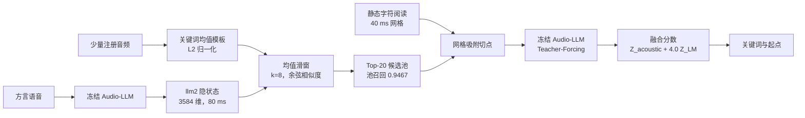

<p align="center">
  <a href="https://github.com/leeoisaboy/audiollm-latent-kws">
    
  </a>
</p>

<p align="center">
  <a href="README.en.md"></a>
  
  
</p>

# AudioLLM-Latent-KWS

**用冻结 Audio-LLM 的浅层声学表征，完成方言开放词表关键词检索。**

智能家居和适老化设备会持续遇到新的方言动作指令。每增加一个词就收集标注、微调模型，成本会落在长尾上。这个项目研究一个更基础的问题。冻结的音频大模型内部，是否已经保存了足够的声学与语义信息，让一个新词只靠少量注册音频就能被检索出来。

仓库提供一条可复算的两阶段流程。第一阶段在 Audio-LLM 的浅层隐空间中做均值模板匹配，产出 Top-20 候选池。第二阶段把候选放回冻结模型的语言上下文，用 Teacher-Forcing 打分重排。模型参数全程保持冻结，外部字符时间戳只作为静态输入。代码同时保留正的工程结果和高价值的阴性结论，重点服务于研究复现与算法审计。

## 最优组合：先给结论

早期版本把 `llm2 + C + Z_acoustic + 1.5 Z_LM` 当作固定设计。`1.5` 只是从更早实验继承的常数，在本次真实语料上没有经过选择。它乘在语言模型项上，不是声学项的权重。声学项系数始终为 1。重新扫描后，当前证据支持的最优实测组合是：

```text
llm2 · k=8 + mean centering · C + phonetic soft snap · Z_acoustic + 4.0 Z_LM · shape off
```

这个组合在同一候选池上取得 **0.5496 occurrence Top-1** 和 **0.6449 词级 Top-1**。不安装可选的音素依赖时，仓库默认走 `C`，对应 0.5416 和 0.6258。前者是当前实测点估计，后者是不依赖额外安装的默认路径。

| 环节 | 当前选择 | 直接证据 |
| --- | --- | --- |
| 隐状态层 | `llm2`，3584 维 | 全量语料 Top-20 池召回 0.9467；现有唯一完成全量验证的层 |
| 模板与窗口 | `k=8` 加 enrollment 均值中心化 | 池召回 0.9467；speaker-disjoint 嵌套 CV 的 occurrence Top-1 增益为 3.699 点 |
| 左文境切点 | `C`，候选首字网格吸附 | 前缀首字污染率从 35.23% 降到 3.39%；C 比错误句对照 X 高 25.8 点 |
| Stage-2 扩展 | `C` 加音素软吸附 | 在 `lambda_LM=4.0` 下比复算 C 高 0.801 点，95% CI [+0.345, +1.262] |
| 融合权重 | `Z_acoustic + 4.0 Z_LM` | 稳定平台为 4.0 到 4.75；相对同一复算 runner 的 `C@1.5` 高 1.850 点，95% CI [+1.183, +2.546] |
| 时序形状 | 关闭 | `lambda_LM=4.0` 的 utterance / speaker 嵌套 CV 为 -0.033 / -0.233 点，95% CI 都跨零 |

这里需要把两个容易混淆的量拆开。声学项没有被削弱，`Z_acoustic` 的系数仍是 1；`1.5` 与 `4.0` 描述的是语义项相对于声学项应该占多大比重。在同一套 Stage-2 复算中，令 `lambda_LM=0` 只保留声学项，occurrence Top-1 为 0.4399；令 `lambda_LM=4.0`，升到 0.5416；令 `lambda_LM=100` 近似去掉声学项，回落到 0.5324。声学项仍然提供增益，但把 LM 权重压在 1.5 会低估语义重排的作用。

统一使用复算 runner 时，`C` 从 `1.5` 的 0.5311 升到 `4.0` 的 0.5416，`C + phonetic` 从 0.5358 升到 0.5496。最优点的 occurrence Top-1 为 **0.5496**，词级 Top-1 为 **0.6449**。

| `lambda_LM` | C，occurrence | C，词级 | C + phonetic，occurrence | C + phonetic，词级 |
| ---: | ---: | ---: | ---: | ---: |
| 1.5，旧默认，统一复算 | 0.5311 | 0.6182 | 0.5358 | 0.6286 |
| 2.0 | 0.5367 | 0.6218 | 0.5419 | 0.6358 |
| 3.0 | 0.5413 | 0.6289 | 0.5478 | 0.6456 |
| 4.0，当前默认 | 0.5416 | 0.6258 | **0.5496** | **0.6449** |
| 4.75，扫描峰值 | 0.5432 | 0.6257 | 0.5499 | 0.6441 |

`4.75` 的 occurrence 点估计只比 `4.0` 高 0.03 点，词级反而略低。utterance 分组的嵌套 CV 五次选择为 `4.75, 4.0, 4.75, 4.25, 4.75`，speaker 分组为 `4.75, 4.75, 4.0, 5.5, 4.0`，两者都落在 4.0 到 4.75 的平台。仓库因此采用更保守的 `4.0`，不把扫描峰值写成唯一最优点。权重变高以后，朴素切分 P 从 0.4538 退到 0.4112，而 C 从 0.5311 升到 0.5416。语义项越重要，错误前缀的代价越大，网格吸附也越不能被省略。

### 层 0 为什么没有直接替换 `llm2`

层 0 确实是层探针的赢家。在 24 个 occurrence、64 条多说话人模板上，层 0 的 Top-20 召回为 1.0000，类间与类内余弦比为 0.4828；`llm2` 分别为 0.9583 和 0.5471。层 0 的模板区分度更好，这个判断成立。

| 候选层 | 探针池召回 | 类间与类内比 | 全量语料 | 当前决策 |
| --- | ---: | ---: | --- | --- |
| 层 0 | **1.0000** | **0.4828** | 尚未导出全量特征 | 下一轮首选实验 |
| `llm2` | 0.9583 | 0.5471 | Top-20 池召回 0.9467 | 当前部署默认 |

全量语料目前只比较过 `llm1`、`llm2`、`llm6` 及其晚融合，没有层 0 的 2031 条话语结果。把 24 个 occurrence 的探针优势直接写成全量最优，会把证据等级抬高。现在最该做的不是继续扫融合权重，而是导出全量层 0 特征，并固定候选池复测。README 因此把层 0 放在“探针最优”，把 `llm2` 放在“已全量验证”，不把两者混成同一个数字。如果只问“类间区分度是否更好”，答案是层 0；如果问“当前可部署配置是否已经优于 `llm2`”，答案仍是尚未验证。

## 为什么做这个项目

方言动作词的分布很稀疏。一个家庭可能只用“拉帘”“调温”“开灯”这几个词，不同地区的读音又有明显差异。为每个家庭、每种方言、每个新词训练一个专用模型，工程成本与收益不成比例。

开放词表关键词检索提供了另一条路径。设备先录几段目标词，再把注册音频变成模板；搜索时直接在连续语音中定位这些词。若冻结 Audio-LLM 的隐空间已经具备跨说话人的声学稳定性，新词注册就能绕过训练。这个假设需要通过实验检验。

第二阶段还有一个容易被忽略的工程问题。Audio-LLM 的声学网格约为 80 ms，外部字符阅读网格约为 40 ms。两种网格直接相除会得到错误的上下文切点。错误切点让候选首字提前出现在语言模型前缀中，真实音频中的首字反而被当成重复内容。这个现象会系统性压低正确候选的分数，单看总准确率很难发现。

项目因此围绕三个问题展开。

1. 冻结 Audio-LLM 的哪一层隐状态最适合跨说话人关键词检索。浅层声学空间的模板能否稳定地区分不同词，同时保持同一词的类内聚合。
2. 异构时间网格应该如何对齐。简单截断造成的“前缀污染”有多大，免训练的网格吸附能否消除这部分损失。
3. 关键词的声学时序形状能否补充语言模型的语义概率。若单看形状有排序能力，它与 LM 分数融合后是否仍然有效。

## 核心结论

| 问题 | 实验结论 | 对系统的含义 |
| --- | --- | --- |
| 哪一层最适合检索 | 层 0 的探针区分度和召回最好，`llm2` 是唯一完成全量验证的层 | 部署保留 `llm2`，层 0 进入下一轮全量实验 |
| `1.5` 是不是好权重 | 它只是历史继承值；同一 runner 下 `4.0` 比 `1.5` 高 1.048 点，音素软吸附再贡献 0.801 点 | 默认改为 `4.0`，报告 4.0 到 4.75 的平台 |
| 异构网格对齐有多重要 | 朴素切分的前缀首字污染率为 35.23%，吸附切法为 3.39% | 对齐策略带来的收益远大于多数参数微调 |
| 时序形状能否补充 LM | 单独有排序能力；`lambda_LM=4.0` 的嵌套 CV 为 -0.033 点且区间跨零 | shape tie-break 默认关闭 |
| 小显存能否复现 | 4-bit NF4 装载在 RTX 4060 Laptop 上完成六层特征导出 | 原型具备本地实验与低成本复现条件 |

这里最容易误读的是层选择与融合权重。层 0 的类间表现更好，不代表全量池召回已经被验证；`1.5` 也不是不可修改的物理常数，它只是一个没有调过的历史值。两个旧默认都在这轮实验中被拆开检查，结论分别落在“等待全量验证”和“已被 4.0 替代”。

## 方法

<p align="center">
  
</p>
<p align="center"><sub>小狗先把候选圈出来，语言模型再核对前缀。定位阶段负责召回，重排阶段负责候选内排序。</sub></p>



### 第一阶段，声学隐空间定位

音频经过冻结 Audio-LLM 后，取第 2 个 decoder block 输出的音频区间隐状态。每一帧为 3584 维，帧移约为 80 ms。一个词的多个注册样本先在关键词区间内取均值，再在样本之间取质心，最后做 L2 归一化，得到模板 $q_w$。

搜索侧对长度 $k$ 的滑动均值窗口计算余弦相似度。

$$
c_{i,w}=\frac{\bar h_{i,i+k-1}}{\lVert \bar h_{i,i+k-1}\rVert_2}\cdot q_w
$$

词级声学分数取窗口响应的最大值，对应窗口起点作为粗定位结果。实验中的当前推荐配置为 `k=8` 加上 enrollment 均值中心化。默认保留 Top-20 进入第二阶段。池召回就是后续单候选决策的上限。

### 第二阶段，前缀对齐的语言模型重排

候选词被接到指令、音频和左文境之后，冻结模型计算候选 token 的平均对数概率。

$$
S_{\mathrm{LM}}(w)=\frac{1}{|\mathrm{tok}(w)|}\sum_t \log P\bigl(\mathrm{tok}(w)_t \mid \text{instruction},\text{audio},\text{prefix}_w,\mathrm{tok}(w)_{<t}\bigr)
$$

默认臂 C 先在 40 ms 字符阅读序列中找到候选首字的最近位置，再把声学窗起点吸附到该位置。前缀因此停在候选首字之前。两个分数在同一个候选池内做标准化，语言模型权重取全量验证后的 4.0。

$$
\mathrm{Score}=Z_{\mathrm{acoustic}}+4.0\,Z_{\mathrm{LM}}
$$

## 实验协议

主实验使用由 WenetSpeech-Wu-Bench 衍生的吴语方言数据，共 2031 条话语、3244 个关键词 occurrence、293 个词。特征来自冻结的 Step-Audio-2-mini，取 `llm2`，每帧 3584 维，帧移 80 ms。候选池固定为 Top-20，Stage-2 语言模型权重取 4.0，稳定性区间为 4.0 到 4.75。

报告同时给出 occurrence Top-1 和词级 Top-1。occurrence Top-1 让每个关键词出现等权。词级 Top-1 先按词平均，再跨词平均。交叉验证按话语或 `rec_sXX` session 分组，窗口和校准只在训练折选择。`rec_sXX` 是数据中的启发式说话人分组，尚未经过官方说话人标注核验。

合成 fixtures 只用于验证代码路径，不作为准确率证据。所有数字都能在 `docs/REAL_CORPUS_RESULTS.md` 与 `docs/layer_sweep.md` 中查到原始记录。

## 对比试验与结果

### 第一阶段，窗口、校准与模板结构

| 配置 | occurrence Top-1 | 词级 Top-1 | Top-20 池召回 |
| --- | ---: | ---: | ---: |
| `k=5` 均值模板，历史基线复算 | 0.4371 | 0.4821 | 0.9251 |
| `k=8` 均值模板 | 0.4732 | 0.5523 | 0.9343 |
| `k=8` 加均值中心化 | **0.4741** | **0.5451** | **0.9467** |
| `k=8` 加 ABTT | 0.3952 | 0.4506 | 0.8634 |
| `k=8` 加 PCA whitening | 0.4319 | 0.4908 | 0.9097 |
| 时长自适应窗口 | 0.4658 | 0.5412 | 0.9340 |
| 2-means 多原型与多尺度 | 0.4498 | 0.5142 | 0.9168 |

`k=8` 加均值中心化是这组候选中唯一稳定提高池召回的方向。speaker-disjoint 嵌套 CV 的 occurrence Top-1 增益为 **3.699 个百分点**，95% CI 为 **[+2.796, +4.607]**。五折都选择了该配置。utterance-grouped 五折增益为 3.514 个百分点，95% CI 为 [+2.624, +4.419]。

ABTT、PCA 白化、时长自适应、多原型和多尺度都没有超过该配置。工程上可以先把复杂模板结构放一边，集中处理时间网格与上下文对齐。

### 层选择，小探针与全量后续

层探针在 RTX 4060 Laptop 上使用 4-bit NF4、double quantization 和 bf16 计算。集合包含 24 个关键词 occurrence 与 64 条多说话人注册模板。层号表示 decoder block 输出，层 0 对应第一个 block 的输出。

| Layer | Top-20 池召回 | 类间余弦 | 类内余弦 | 类间与类内比 |
| ---: | ---: | ---: | ---: | ---: |
| 0 | 1.000000 | 0.446985 | 0.925754 | **0.482834** |
| 1 | 0.958333 | 0.513000 | 0.933310 | 0.549657 |
| 2 | 0.958333 | 0.511176 | 0.934279 | 0.547134 |
| 3 | 0.958333 | 0.528191 | 0.936630 | 0.563927 |
| 4 | 0.958333 | 0.549397 | 0.939740 | 0.584627 |
| 8 | 1.000000 | 0.602525 | 0.945296 | 0.637394 |

小探针上层 0 同时取得全召回和最低的类间与类内比。Layer 8 也达到全召回，但模板区分度最弱。Layer 2 丢掉 24 个 occurrence 中的一个，两个区分度指标都落后于层 0。

全量语料后续比较了现有层视图的晚融合结果。

| 层视图 | Top-20 池召回 |
| --- | ---: |
| `llm1` | 0.9337 |
| `llm2` | **0.9467** |
| `llm1:0.5 + llm2:0.5` | 0.9414 |
| `llm1:0.3 + llm2:0.7` | 0.9436 |
| `llm2:0.7 + llm6:0.3` | 0.9396 |
| `llm1:0.5 + llm2:0.3 + llm6:0.2` | 0.9371 |

全量实验没有观察到现有层视图的融合收益，默认仍使用 `llm2`。这不是“层 2 优于层 0”的结论，而是证据等级不同：层 0 只有 24 个 occurrence 的探针结果，尚未导出 2031 条话语的全量特征。下一轮最值得做的实验是固定同一候选池，补全层 0 的全量导出与评测。

### 七臂消融，时间网格对齐

七臂使用同一候选池、同一冻结模型和同一融合权重，只改变左文境构造。下表来自较早的公开工作点，当时 Top-20 池召回为 0.9266。该表用于对齐机制归因，不能与当前 0.9467 基线的数字逐项混用。

<p align="center">
  
</p>
<p align="center"><sub>两种时钟指向同一个边界。吸附只移动切点，冻结模型和融合权重不变。</sub></p>

| Arm | 左文境规则 | 按词 Top-1 |
| --- | --- | ---: |
| A | 不提供左文境 | 0.2233 |
| P | 80 ms 窗起点直接截断 40 ms 阅读 | 0.3591 |
| X | 使用另一句的阅读文本，保持相同切点 | 0.3597 |
| S | 每句共用声学 Top-1 的吸附切点 | 0.5457 |
| T | 真值文本截到相同长度 | 0.5763 |
| C | 候选首字网格吸附 | **0.6172** |
| O | 使用真值句子的切点 | 0.6444 |

Arm P 与错误句子对照 X 的结果几乎相同。这个对照说明，朴素切分的主要损失来自对齐错误，任意上下文并不能弥补。Arm C 比 X 高 **25.8 个百分点**。Arm T 和 O 需要转写或真值时间戳，只用于观察剩余上限，不进入部署路径。

前缀污染审计给出了更直接的解释。

| 污染口径 | P，朴素切分 | C，网格吸附 |
| --- | ---: | ---: |
| 前缀包含候选首字 | 0.3523 | 0.0339 |
| 前缀以候选首字结尾 | 0.3419 | 0.0173 |

约三分之一的 P 候选会在前缀里提前看到自己的首字。因果语言模型随后被要求重新预测已经出现的 token，定位正确的候选反而受到惩罚。网格吸附把这一类污染降到 3% 左右。

### 第二阶段，复算与扩展分支

全部 2031 条话语使用同一候选池。下表统一在 `lambda_LM=4.0` 下复算，并保留历史公开 C 的 `1.5` 工作点作参照。历史 C 与复算 C 仍有 runner 差异，项目把它单独标出，不当作新收益。KV-cache 路径已有逐值一致性审计。

| 分支，`lambda_LM=4.0` | occurrence Top-1 | 词级 Top-1 | 相对复算 C |
| --- | ---: | ---: | ---: |
| P，朴素切分 | 0.4112 | 0.4308 | -13.04 个百分点 |
| C，复算并启用 KV cache | 0.5416 | 0.6258 | 0 |
| **C 加音素软吸附** | **0.5496** | **0.6449** | **+0.801 个百分点** |
| C 加 Top-2 NMS 起点 | 0.5484 | 0.6383 | +0.678 个百分点 |
| C 加 PMI，`gamma=0.25` | 0.5438 | 0.6278 | +0.216 个百分点 |
| 历史公开 C，`lambda_LM=1.5` | 0.5370 | 0.6266 | +0.59 个百分点，runner 差异 |

音素软吸附相对复算 C 的增益为 **0.801 个百分点**，95% CI 为 **[+0.345, +1.262]**。这是当前增益最大、同时提高 occurrence 与词级指标、且置信区间不跨零的 Stage-2 扩展。它需要安装 `.[phonetic]` 并在 `rerank` 时传入 `--phonetic-snap`，因此核心路径仍保持 C，推荐组合按需启用。

Top-2 NMS 在 `4.0` 下也转为稳定正收益，95% CI 为 [+0.187, +1.175]，但两个点估计都低于音素软吸附。PMI 的 `gamma=0.25` 只有 +0.216 点，`gamma=1.00` 退到 0.5071，仍不进入默认路径。

### 时序形状，诊断信号与融合失效

形状臂把候选窗口的时序变化转成相似度分数。单独使用时，一阶差分 `d1` 的 occurrence Top-1 为 0.2132，线性重采样为 0.4069，subsequence DTW 为 0.3633。DTW 的单臂排序弱于线性重采样，但对语言模型犹豫的样本有互补信息。

| 基线 | 形状信号 | 分组 | occurrence Top-1 变化 | 95% CI |
| --- | --- | --- | ---: | --- |
| LM-only | DTW 门控 | speaker 五折 | **+0.832 个百分点** | [+0.264, +1.449] |
| `acoustic + 1.5 LM` | 全部形状臂 | utterance 五折 | -0.333 个百分点 | [-0.605, -0.098] |
| `acoustic + 1.5 LM` | 全部形状臂 | speaker 五折 | -0.399 个百分点 | [-0.741, -0.068] |
| **`acoustic + 4.0 LM`** | **全部形状臂** | **utterance 五折** | **-0.033 个百分点** | **[-0.332, +0.268]** |
| **`acoustic + 4.0 LM`** | **全部形状臂** | **speaker 五折** | **-0.233 个百分点** | **[-0.533, +0.065]** |

DTW 在 LM-only 诊断基线上有稳定增益。把声学项放回融合后，`1.5` 权重下形状信号稳定为负；改到 `4.0` 后，utterance-grouped 嵌套 CV 回到零附近，speaker-grouped 为 -0.233 点且区间跨零。两种分组都没有正收益。这个差异说明局部声学变化与全局语义概率的分布并不同步，简单线性组合无法兑现单臂里看到的排序能力。

项目因此把 shape tie-break 定位为审计算子，默认关闭。若后续工作要继续利用时序信息，需要新的条件化机制与独立留出验证，不能直接沿用固定权重。

### KV cache 与低成本推理

缓存路径只前向一次音频前缀，再按共享前缀增量解码候选。H20、20 个候选、fp16、五次 warm run 的中位数显示 **1.30 到 2.14 倍**加速。收益不大，因为候选字符串通常只有 1 到 4 个 token，基线已经按同长度候选批处理。

200 条话语的一致性审计中，最大分数差为 0.0391 到 0.0469 nats，最小 Spearman 为 0.997。C 臂的 Top-1 有 199/200 条保持一致，四项报告指标完全相同。项目不宣称 5 到 10 倍加速，也不宣称 80% 显存下降。

特征导出支持 `0,1,2,3,4,8` 六层一次前向保存。5 GB 级 GPU 可使用 NF4 4-bit、double quantization 和 fp16 计算完成基础特征提取。公开 runner 的 4-bit 路径用于 base extractor，adapter merge 需要使用非量化模型路径。

## 这个原型有什么意义

第一层意义是可复现的基线。开放词表方言 KWS 常把注册、定位、语言模型重排和阈值校准混在一个黑箱里。这个仓库把四段拆开，分别输出池召回、候选内 Top-1、前缀污染率和缓存一致性。研究者可以替换其中一段，同时保留其余对照。

第二层意义是对齐诊断。异构时间网格的问题在级联系统里普遍存在。这里给出了可量化的污染指标和一组只改变左文境的对齐臂。`C` 与 `X` 的 25.8 个百分点差距说明，上下文位置的选择可以决定重排是否有效。

第三层意义是负结果的可复用性。PMI、ABTT、PCA 白化、多原型、现有层融合和固定权重的时序形状都经过真实语料测试。除音素软吸附外，这些扩展没有进入推荐路径；Top-2 NMS 在 `4.0` 下转正，但仍低于音素软吸附。后续工作可以直接避开这些方向，或针对失败原因设计新实验。

工程上，这套原型展示了本地注册和本地搜索的可行路径。设备只需要少量目标词录音，模板与隐状态都可在本地生成，模型不用更新。它适合做智能家居与适老化设备的方言指令研究基线。生产唤醒还需要远场鲁棒性、误唤醒率、实时延迟、功耗、拒识和更多方言的独立评测，这些指标尚未在本项目中建立。

## 已知边界

- 主实验只覆盖一个 2031 条话语的吴语语料，不能据此声称跨方言泛化。
- 说话人分组来自 `rec_sXX` 启发式字段，尚未经过人工核验的官方 speaker ID 标注。
- 4-bit 特征层 sweep 只有 24 个 occurrence，结论用于提出候选层，尚不足以替代全量评测。
- 层 0 的类间优势来自 24 个 occurrence 的探针，全量层 0 特征尚未导出，不能当作全量最优。
- 音素软吸附在 `lambda_LM=4.0` 下比复算 C 高 0.801 点，但仍只在一个语料上验证，需要第二套独立语料复核。
- `4.0` 到 `4.75` 是当前语料上的稳定平台，权重选择仍需要跨语料的外部验证。
- PMI、ABTT、PCA 白化、多原型和现有层视图融合没有稳定的真实语料净收益；Top-2 NMS 在 `4.0` 下为正，但低于音素软吸附。
- shape tie-break 在 `lambda_LM=4.0` 下没有正收益，默认关闭。
- 这个仓库是研究原型，尚未达到生产唤醒系统标准。

## 仓库结构

| 目录 | 职责 |
| --- | --- |
| `locator/` | 第一阶段，均值模板、滑窗余弦、候选池与可选校准 |
| `reranker/` | 第二阶段，字符网格吸附、左文境构造与 Teacher-Forcing 打分 |
| `analysis/` | 前缀污染审计、层比较、形状算子和不参与决策的分析工具 |
| `integration/` | Step-Audio-2 特征导出与低显存装载适配 |
| `scripts/` | 真实语料消融、交叉验证、层融合和缓存基准入口 |
| `data/` | 公开 schema、脱敏示例与确定性合成夹具 |
| `docs/` | 架构、复现清单、模型说明与真实语料结果 |
| `tests/` | 定位、对齐、打分、形状和模型装载保护的单元测试 |

## 快速开始

```bash
git clone https://github.com/leeoisaboy/audiollm-latent-kws.git
cd audiollm-latent-kws
python -m venv .venv
python -m pip install -e ".[dev]"
python scripts/make_fixtures.py --output data/synthetic
```

用合成夹具跑通完整数据流。这里的分数只验证接口连通，不代表真实模型效果。

```bash
python cli.py locate \
  --templates data/synthetic/templates.jsonl \
  --enroll-dir data/synthetic/enroll \
  --search-manifest data/synthetic/search_manifest.jsonl \
  --search-dir data/synthetic/search \
  --latent-width 16 \
  --window 8 \
  --whitening center \
  --pool-top 20 \
  --include-gold \
  --output reports/pool.jsonl

python cli.py evaluate \
  --pool reports/pool.jsonl \
  --pool-top 20 \
  --output reports/stage1.json

python cli.py rerank \
  --pool reports/pool.jsonl \
  --reading data/synthetic/readings.jsonl \
  --wav-dir data/synthetic \
  --scorer examples.dummy_scorer:create_scorer \
  --variants A,P,X,S,C \
  --null-shift 1 \
  --output reports/lm.jsonl

python cli.py fuse \
  --pool reports/pool.jsonl \
  --lm reports/lm.jsonl \
  --variant C \
  --lambda-lm 4.0 \
  --output reports/metrics.json

python cli.py audit \
  --pool reports/pool.jsonl \
  --lm reports/lm.jsonl \
  --reading data/synthetic/readings.jsonl \
  --null-shift 1 \
  --output reports/prefix_audit.json
```

如果安装了 `python -m pip install -e ".[phonetic]"`，在 `rerank` 命令中加入 `--phonetic-snap`，即可得到推荐组合中的音素软吸附分支。

真实 Audio-LLM 特征提取需要私有音频清单与冻结模型。下面命令一次导出六层。

运行真实模型路径前，安装可选依赖 `python -m pip install -e ".[stepaudio2]"`。

```bash
python integration/step_audio2.py \
  --model /path/to/Step-Audio-2-mini \
  --manifest /private/path/all_clips.jsonl \
  --enroll-manifest /private/path/enroll_manifest.jsonl \
  --search-manifest /private/path/search_manifest.jsonl \
  --output-root features \
  --layers 0,1,2,3,4,8 \
  --quantization 4bit \
  --dtype float16 \
  --min-duration 0.32 \
  --max-duration 12.0
```

层比较命令如下。

```bash
python cli.py compare-layers \
  --features-root features \
  --templates data/reference/templates.jsonl \
  --search-manifest data/dialect_kws_testset/manifest.jsonl \
  --layers 0,1,2,3,4,8 \
  --latent-width 3584 \
  --pool-top 20 \
  --output reports/layer_comparison.json
```

真实重排需要一个实现 `AudioLMScorer` 接口的私有 runner。公开仓库不包含模型权重、受限音频、真实说话人信息或识别器输出。

## 数据与模型

公开示例只使用“开灯”“关窗”“拉帘”“调温”等中性生活指令。真实音频、注册清单、字符时间戳、派生隐状态和评测报告都应保存在私有环境，并按各自数据许可管理。

吴语资源入口见 [WenetSpeech-Wu](https://huggingface.co/datasets/ASLP-lab/WenetSpeech-Wu)。模型与适配器的公开名称和装载约束见 [docs/MODELS.md](docs/MODELS.md)。仓库不分发权重或语料。

## 复现与测试

```bash
python -m compileall -q .
python -m pytest -q
```

详细复现步骤见 [docs/REPRODUCE.md](docs/REPRODUCE.md)，真实语料数字见 [docs/REAL_CORPUS_RESULTS.md](docs/REAL_CORPUS_RESULTS.md)，层 sweep 见 [docs/layer_sweep.md](docs/layer_sweep.md)。

代码使用 Apache-2.0。数据、模型和派生特征保留原始许可。示例文件不构成可再分发的语料。

**这个项目最有价值的产出，是一套能解释成功与失败的冻结 Audio-LLM 关键词检索基线。**
